# LaserCraft — User Manual

This manual walks you through LaserCraft from the first start to your first finished engraving.
For a short overview see the [README](README.md).

**Contents**

1. [Safety first](#1-safety-first)
2. [Installation](#2-installation)
3. [The main window](#3-the-main-window)
4. [Connect to your laser](#4-connect-to-your-laser)
5. [Load something to engrave](#5-load-something-to-engrave)
6. [Position the work](#6-position-the-work)
7. [Run a job](#7-run-a-job)
    - [Layout editor, layers and projects](#7b-layout-editor-layers-and-projects)
    - [Tools: test patterns, materials, profiles, statistics, network, camera](#7c-tools)
8. [Sounds, alerts and notifications](#8-sounds-alerts-and-notifications)
9. [Console and G-code list](#9-console-and-g-code-list)
10. [Grbl configuration](#10-grbl-configuration)
11. [Custom buttons](#11-custom-buttons)
12. [Settings](#12-settings)
13. [Languages and appearance](#13-languages-and-appearance)
14. [Menus and keyboard shortcuts](#14-menus-and-keyboard-shortcuts)
15. [Troubleshooting](#15-troubleshooting)
16. [Glossary](#16-glossary)

---

## 1. Safety first

Laser light can permanently damage eyes — also reflected light — and can start fires.

- Wear **laser safety glasses that match your laser's wavelength** whenever the laser can fire.
- Protect everyone nearby, or use an enclosure.
- Only engrave materials that are safe to burn; remove flammable things from the area.
- **Stay at the machine** and keep a **fire extinguisher** within reach.
- Know where the machine's **power switch** is. The *Stop* button in LaserCraft is not an emergency stop.

LaserCraft reminds you before every start (see [Run a job](#7-run-a-job)), but the responsibility stays with you.

> LaserCraft is a beta: it works on a real Grbl 1.1 laser (Seeeduino Nano) and is tested against a simulated controller, but your
> machine may differ. For your first run use low power,
> cover the optics, or let the machine "draw" with the laser off (Frame power 0).

## 2. Installation

**Requirements:** macOS 14 (Sonoma) or newer, a laser with a **Grbl 0.9 / 1.1** controller, a USB cable.

1. Download `LaserCraft.zip` from the Releases page and unzip it, or build the app with `./scripts/build_app.sh`.
2. Drag **LaserCraft.app** into your *Applications* folder.
3. The first time, **right-click the app → Open** and confirm (the downloadable app is signed ad hoc, not notarised; notarising needs
   a paid Apple Developer account — see `docs/RELEASING.md`). The app runs natively on Apple silicon and Intel Macs.

Many laser controllers use a CH340 USB chip. Recent macOS versions include a driver; if no port appears when the laser is
plugged in, install the chip maker's driver.

## 3. The main window

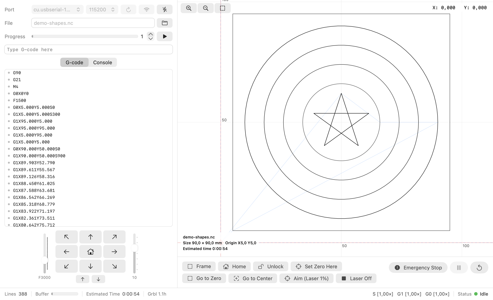

The window is arranged like the Windows version of LaserGRBL.

**Left column (top to bottom)**

| Area | What it does |
|---|---|
| **Port** | Choose the serial port and baud rate, refresh the list, **connect / disconnect** (plug button). |
| **File** | Name of the loaded G-code; the folder button opens a file. |
| **Progress** | Progress bar with the remaining time, number of **passes**, and the **Start** button. |
| **Type G-code here** | Send a single command to the machine (e.g. `$$` or `G0 X10`). ↑ / ↓ recalls earlier commands. |
| **G-code / Console** | The G-code lines with ✓ (accepted) and ✕ (error), or the messages between app and machine. |
| **Jog pad** | Move the laser head. Left slider: speed. Right slider: step size. Small arrows: Z axis. |

**Right side**

| Area | What it does |
|---|---|
| **Preview** | The job as the laser will draw it: dark lines are burning, thin blue lines are travel moves, green is already done. The red cross is the laser. **X / Y** (top right) is the current work position. Use the magnifier buttons, pinch or drag to zoom and pan; the square button fits the job. |
| **Button row** | *Frame*, *Home*, *Unlock*, … and your own buttons. At the right: **Pause / Resume** and **Stop / Reset**. |
| **Toolbar** (top right of the window) | *Open G-code*, *Import Image*, *Save G-code*, *Grbl configuration*. |

**Status bar:** number of lines, Grbl's receive **buffer**, **estimated time**, messages (alarms in red), the **overrides**
S / G1 / G0 (click one to change it), and the machine **status**.

The window title shows the loaded job, the subtitle the machine state.

## 4. Connect to your laser

1. Switch the laser on and connect it with the USB cable.
2. Pick the **port** (it looks like `cu.usbserial-…` or `cu.wchusbserial…`). Press the refresh button if it is missing.
3. Leave the **baud rate** at **115200** unless your controller says otherwise.
4. Press the **plug button** (or **⌘K**).

**No laser at hand?** Choose **Simulator (demo machine)** in the port list and connect. It behaves like a Grbl 1.1 laser
(status, buffer, jogging, overrides, pause, errors) and moves at the programmed speed, a little faster than real time. Like many
diode lasers it has no homing switches, so *Home* answers `error:5`. You can hide it in *Settings → Connection*.

When the controller answers you hear a short sound and the status turns to **Idle**. If it cannot connect you get a sound and
an alert with hints. **Settings → Connection** can connect automatically at launch.

If the status shows **Alarm** (common after power-up), press **Unlock** or run **Home** if your machine has limit switches.

## 5. Load something to engrave

### Open a G-code file

Press **Open G-code** (**⌘O**), drop a file on the window, or double-click it in Finder. The preview, size and time estimate
appear. Try `examples/demo-shapes.nc`.

You can **save** the job again with **⌘S** — header, footer and passes from *Settings → Job* are included.

### Turn a picture into an engraving

Press **Import Image** (**⌘I**) and choose a picture (PNG, JPEG, BMP, TIFF, GIF, HEIC). Try `examples/sample-picture.png`.

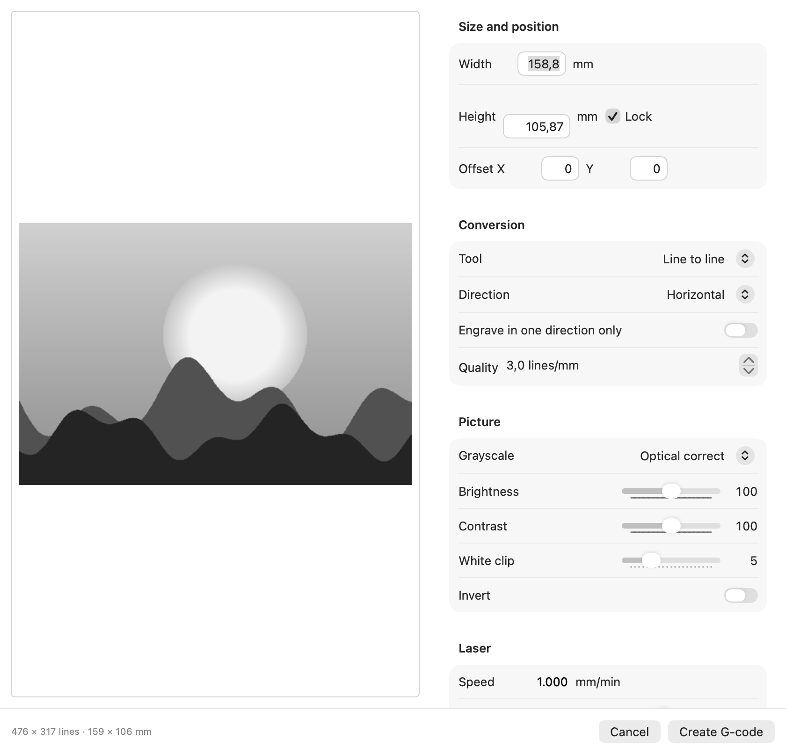

| Group | Setting | Meaning |
|---|---|---|
| Size and position | **Width / Height** | Size of the engraving in mm. **Lock** keeps the proportions. |
| | **Offset X / Y** | Where the engraving starts, in mm from the work origin. |
| Conversion | **Tool** | *Line to line*: grayscale engraving with varying power. *1 bit dithering*: black and white dots — best for low-power lasers. |
| | **Direction** | Horizontal, vertical or diagonal lines. |
| | **Engrave in one direction only** | Slower, but avoids slight offsets between left-to-right and right-to-left lines. |
| | **Quality** | Lines per mm. Higher = finer and slower. |
| | **Dithering** | Method for the dithering tool (Floyd-Steinberg, Atkinson, Burkes, Jarvis-Judice-Ninke, Random, Sierra 2/3/Lite, Stucki). |
| Picture | **Grayscale** | How colours become gray (simple, weighted, optical, or custom red/green/blue mix). |
| | **Brightness / Contrast** | 100 = unchanged. |
| | **White clip** | Very light areas are not engraved at all. |
| | **Invert** | Swap dark and light. |
| Laser | **Speed** | Engraving speed in mm/min. |
| | **Power min / max** | Power range in % of the machine's maximum (`$30`). |
| | **Scan offset** | For two-way engraving: shifts the lines that run backwards by this many mm (the laser lags a little, so the backward lines land off and edges look jagged). Find the value with the *Scan offset* test pattern. Shown only when *Engrave in one direction only* is off. |
| | **Laser mode** | M3 constant power, or **M4 dynamic power** (recommended with Grbl laser mode `$32=1`). |
| | **Machine supports power control (PWM)** | Turn off only for machines that can switch the laser on/off but not dim it. |

**Preset** — the first group stores all settings of this dialog. Built in: *Photo*, *Fast draft*, *Fine detail*, *Sharp logo*,
*Black and white dots*. **Save Preset…** keeps your own, the bin deletes it.

**Crop and Rotate** — rotate by 90° (left / right), mirror horizontally or vertically and crop each edge with a slider.
**Crop to Subject** finds the motif by itself and cuts away the empty border around it (transparent or flat-colour background);
**Reset Crop** puts the picture back. The
preview and the size follow; with **Lock** on, the height adapts to the new proportions.

**Resolution helper** (under *Quality*) — enter the **Laser spot size** (the width of the burnt line, typically 0.1–0.2 mm for
diode lasers). LaserCraft suggests a quality in lines/mm, warns when lines are closer together than the spot (they overlap and
burn the material twice) and shows the **engraving time** in the bottom bar.

The left side shows a live preview of what will be engraved (dark = more power). Press **Create G-code**; the result appears in
the main window and can be saved or run like any other job.

### Import an SVG file

*File → Import SVG…* (**⇧⌘I**) or drop an `.svg` file on the window. LaserCraft reads paths (lines, curves, arcs), rectangles,
circles, ellipses, polygons, groups and transforms, and uses the file's size (`mm`, `cm`, `in`, `pt`; unitless sizes are
96 dpi like in browsers and Inkscape, or 72 dpi for Illustrator files). Text, images, gradients and clip paths in the SVG are
not read: convert text to paths first.

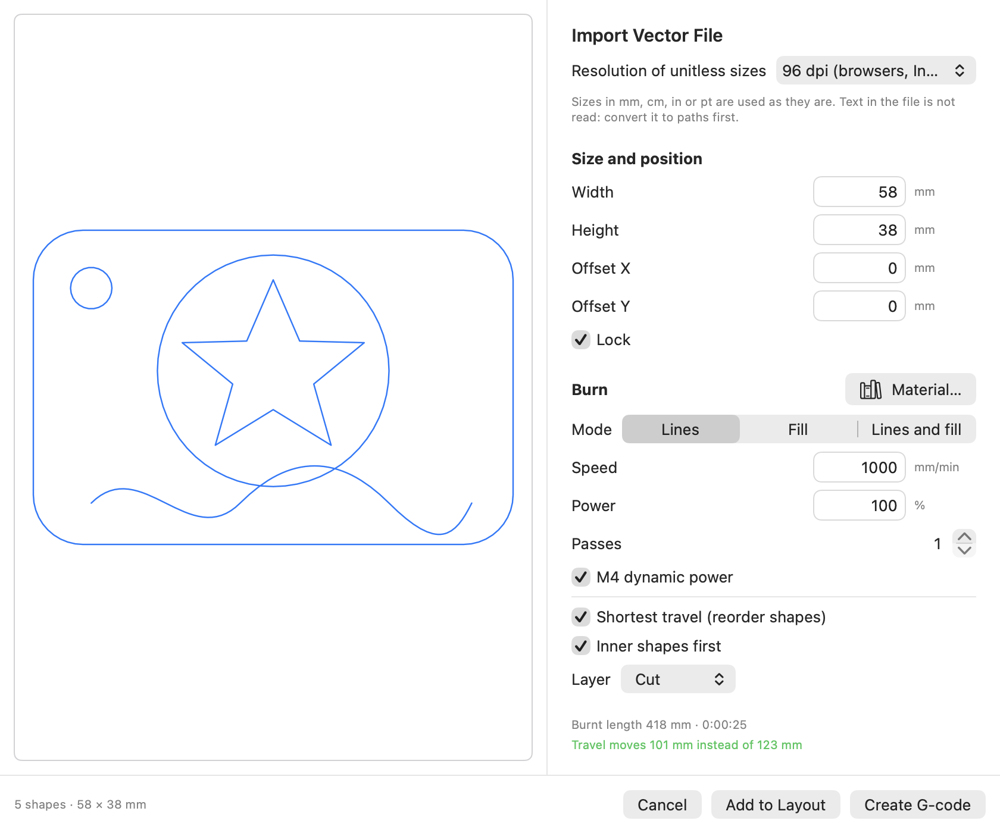

### Import a DXF or PDF file

The same command (*File → Import Vector File…*, **⇧⌘I**, or drop the file on the window) also reads **DXF** and **PDF** files.

- **DXF** (ASCII, from CAD programs, LibreCAD, Fusion, Inkscape export): lines, arcs, circles, ellipses, polylines (with their
  rounded corners), splines and blocks (also scaled and turned) are read. The drawing's units are converted to mm; if the file
  does not name them, 1 unit is 1 mm. The layer names come along. Text, hatches, dimensions, 3D solids and paper space are not
  read. *Binary* DXF files must be saved again as ASCII.
- **PDF:** the vector lines of the chosen page (a page selector appears for longer files) at their real size. Pictures and scanned
  pages are not vector data: use *Trace Image* for them. Text is only read if the PDF stores it as outlines; a white page-sized
  background rectangle is ignored.
- Files are checked while reading: shapes with impossible coordinates are dropped, so a damaged file gives a clear message
  instead of a crash.

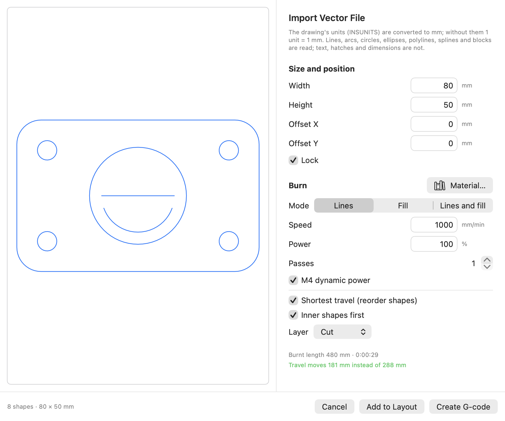

Try `examples/sample-bracket.dxf` (a plate with four holes, a slot and an engraved mark on separate layers).

- **Size and position:** scale the artwork (with **Lock** the proportions stay) and move it.
- **Burn:** *Lines* burns the outlines (cutting, scoring), *Fill* hatches the closed shapes (engraving areas, with a line
  distance and angle), *Lines and fill* does both. Choose speed, power and passes — or pick a **Material…** from the database.
- **Shortest travel** re-orders the shapes so the laser moves less between them (the sheet shows how many mm are saved);
  **Inner shapes first** cuts holes before the outline, so a piece never moves while it is being cut.
- **Create G-code** replaces the job; **Add to Layout** puts the artwork into the layout editor (see below).

### Add text

*File → Add Text…* lays out a text: several lines, alignment, letter height, line and letter spacing.

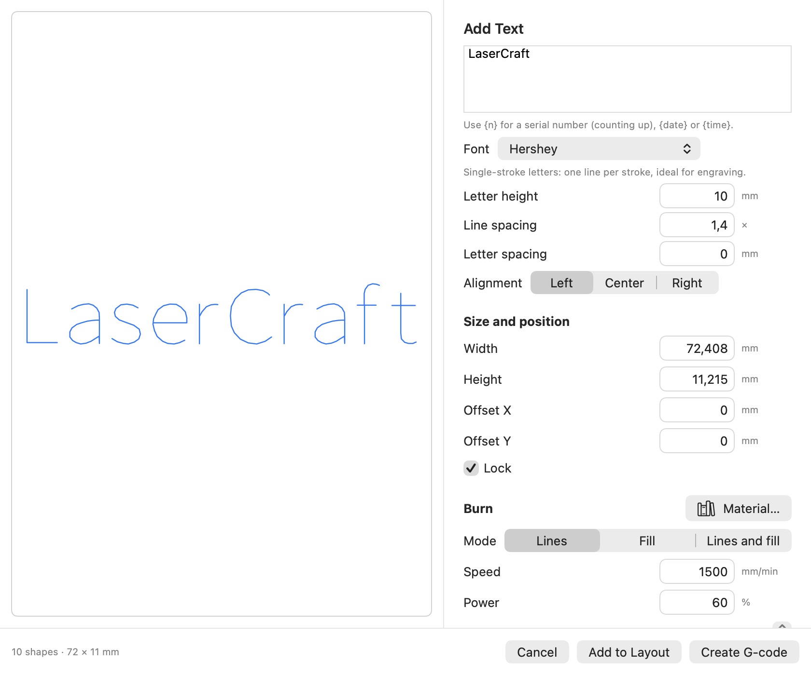

The **Hershey** font consists of single strokes — the laser draws every letter in one go, which is fast and ideal for
engraving. Any installed font can be used too; then the outlines of the letters are burnt (or filled). For series production
type `{n}` for a serial number (`{n:3}` gives 001, 002 …), `{date}` or `{time}`; the number is set in the layout inspector.

### Trace a picture

*File → Trace Image…* turns a picture (logo, drawing, scan) into outlines that can be cut or engraved as lines.

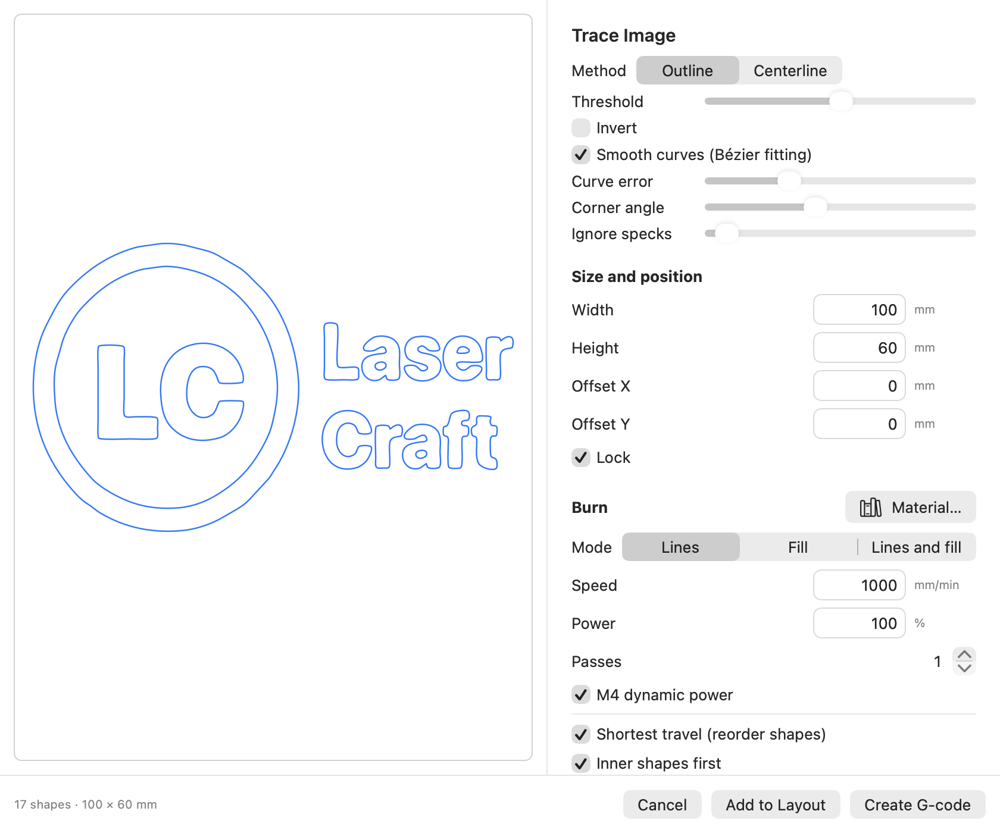

*Outline* follows the edges of dark areas; *Centerline* draws one line through the middle of thin strokes (handwriting,
line art). **Threshold** decides what counts as dark and **Ignore specks** removes dust. With **Smooth curves (Bézier fitting)**
(on by default) LaserCraft fits cubic Bézier curves through the outline: round shapes become really round, the job has far fewer
lines, and corners stay sharp. **Curve error** is how far a curve may stay from the pixels (higher = smoother, fewer points) and
**Corner angle** is the turn from which a point counts as a corner. Switch the option off to get the old method (stairs rounded
by *Smoothing* and reduced by *Simplify*). The tracer is LaserCraft's own implementation (contour following, corner detection and
Schneider curve fitting), not a port of Potrace; the fitted curves are written to the job as short, evenly accurate line segments.

## 6. Position the work

**Click to move:** double-click in the preview to move the laser head (laser off) to that spot. The pointer's position in mm is
shown under the X / Y read-out while you move the mouse over the preview. Jogging works while the machine is **Idle**.

Use the **jog pad**: the arrows move the head by the **step** (right slider, 0.1 – 100 mm) at the **speed** (left slider).
The house button goes to the work origin (X0 Y0). The small arrows move the Z axis (if your machine has one).
Jogging works while the machine is **Idle**.

**Keyboard and continuous jogging.** With the main window active and no text field being edited the keyboard moves the head:

| Key | Action |
|---|---|
| **←  →  ↑  ↓** | Jog by one step |
| **⌥ + arrow** | Big step (10 × the jog step) |
| **⇞ / ⇟** (Page up / down) | Z axis up / down |
| **+ / −** | Larger / smaller jog step |
| **]  /  [** | Faster / slower jog speed |
| **⌃↑ / ⌃↓** | Power override +10 % / −10 % |
| **⌃1 … ⌃9** | Run the custom button with that number (safety check applies) |

*Settings → Keyboard* lists every action with its key. Click a key, press the new combination (**Esc** cancels, **⌫** clears it);
if the combination is already used LaserCraft says so and offers to **Replace** it. *Restore Default Shortcuts* resets all of them.
The diagonal directions have no key by default. Switch on **Hold a key or pad button to keep moving** and the head moves for as long
as a key or pad button is held and stops the moment it is released (Grbl 1.1; the head is fed in short pieces, so it never runs
past the machine limits). That is handy together with the camera.

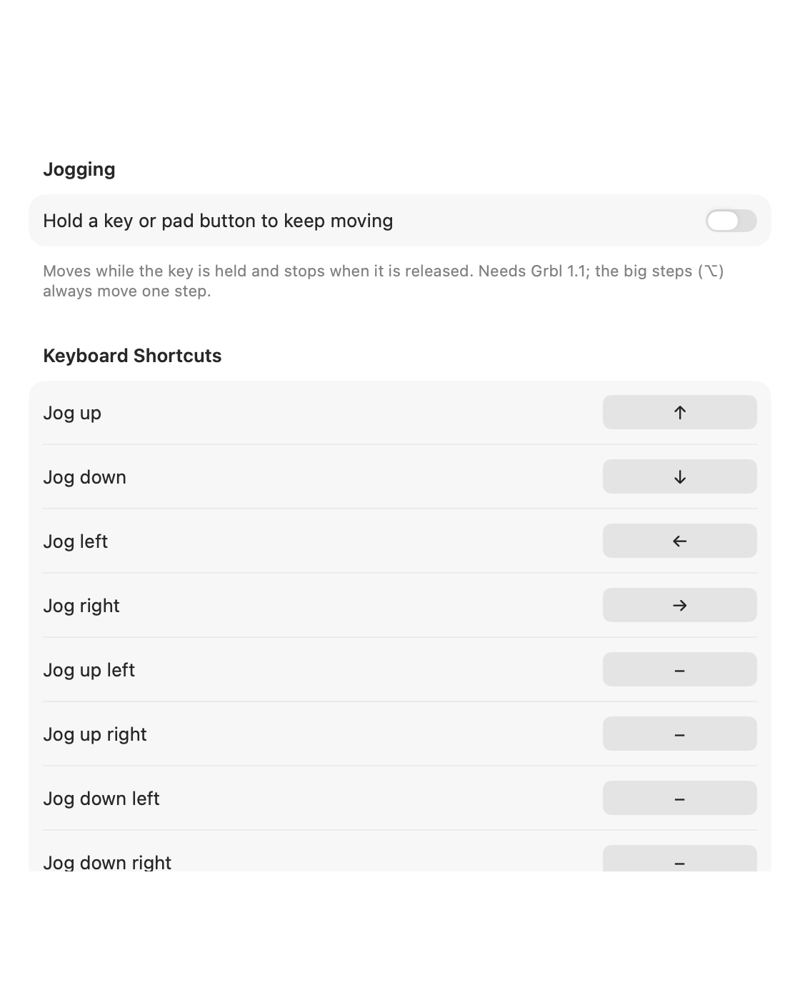

| Button | What it does |
|---|---|
| **Home** (`$H`) | Runs the homing cycle (machines with limit switches). |
| **Unlock** (`$X`) | Clears an alarm without homing. |
| **Set Zero Here** | Makes the current position the work origin X0 Y0 (asks first). |
| **Go to Zero** | Moves to X0 Y0. |
| **Go to Center** | Moves to the middle of the work area (half of `$130` / `$131`, in work coordinates). Needs a connection, so that the machine size is known. |
| **Frame** | Traces the outline of the job so you can check where it will be burned. With *Frame power* 0 the laser stays off; a value above 0 switches it on and shows the [safety check](#7-run-a-job). Set the power in *Settings → Job*. |
| **Aim (Laser 1%)** / **Laser Off** | Switches a very weak laser spot on or off for aiming (safety check applies). |

## 7. Run a job

1. Load a job and press **Start** (green play button, **⌘R** or *Job → Start*).
2. The **safety check** appears. If the job does not match the machine it also lists **warnings** (see below):

   

   - A **5-second countdown** ticks (one sound per second); the *Start* button counts down with it.
   - Tick **"I am wearing laser safety glasses."**
   - When the countdown is over and the box is ticked, *Start* becomes available. **Cancel** aborts. The job starts only after you confirm.

   The same check protects every button that switches the laser on (for example *Aim*) and *Frame* with power above 0.
   It cannot be turned off.
3. While the job runs:

   

   - The **G-code list** shows ✓ for accepted lines and scrolls along; the preview turns **green** where the laser has been.
   - The progress bar shows the remaining time estimate.
   - **Pause** (feed hold) stops the movement; the same button becomes **Resume**.
   - **Stop** removes the rest of the job, holds the machine and resets Grbl so the laser turns off. The position is kept.
   - Click **S**, **G1** or **G0** in the status bar to change power, speed or rapid speed **during** the job (Grbl 1.1).
4. **Save G-code…** (**⌘S**) asks what to write: header and footer on or off, the number of passes, and the line endings (**LF** for macOS
   and Linux, **CRLF** for Windows programs). The choice is remembered.

   
5. When the job ends you hear a sound and get a macOS notification. Header and footer lines (Settings → Job) are sent
   before and after your G-code; with several **passes** the job is repeated.

**Warnings before the start.** When the machine's settings are known, LaserCraft compares the job with the machine and lists
problems in the safety dialog (and in the preview legend, in orange). The machine area turns **red** in the preview if the job
is larger than the machine.

| Warning | Meaning |
|---|---|
| The job is … mm wider / taller than the machine's travel | The job is larger than `$130` / `$131`. |
| The job reaches … mm beyond the … edge | With soft limits (`$20=1`): the job sticks out of the machine area from the current work origin. |
| Laser mode (`$32`) is off | With laser mode off the laser stays on during travel moves and M4 does not change power dynamically. |
| The job uses power up to S… | The job uses S values above the machine's maximum `$30`; Grbl limits them. |
| The job asks for speeds up to … | Faster than the machine's maximum rate `$110` / `$111`; Grbl limits it. |

Warnings never block a job by themselves — you decide — but they usually point at a real problem.

**Resume a job from a line.** After a stop, a lost connection or an alarm choose *Job → Resume Job from Line…* (or right-click a
G-code line → *Start Job from This Line…*). LaserCraft remembers where the last run stopped and suggests a line a few lines
earlier (Grbl had already buffered some). The dialog shows what is sent first (laser off): it travels to the end of the
previous line, restores units, feed rate and motion mode, and switches the laser on again only with the last command.
**Set the work zero to the same position as before** (do not move the material) — otherwise the result is shifted. The usual
safety check is shown before the start.

**Auto-cooling.** In *Settings → Job → Cooling* switch on *Pause regularly to let the laser cool down* and choose the work time
and the rest time. When the work time is over the job is paused with the laser off ("Cooling mm:ss" in the status bar) and
continues by itself; **Resume** carries on earlier. A job counts as finished only when Grbl is idle again, so the last move is
never cut short.

**Auto-reconnect.** With *Settings → Connection → Reconnect automatically…* LaserCraft tries to reconnect when the USB connection
drops while no job is running. A running job is always stopped for safety and you get an alert instead.

**Emergency Stop.** The red **Emergency Stop** button next to *Pause* and *Stop* (also **Machine → Emergency Stop**, **⌥⌘.**) is
always there when the machine is connected. It needs no confirmation and works in every state — during a job, a jog or when
idle: it cancels any jog, stops the motion, resets Grbl (which switches the laser off), ends a running job as *stopped* and sends
`M5` afterwards. Use it whenever something looks wrong; afterwards check the machine, press **Unlock** or **Home** if needed.
The emergency stop is a software function: it does not replace the power switch or a hardware emergency stop of your machine.

**Buffer watchdog.** If an "ok" from Grbl gets lost (noise on the cable, a USB hiccup) a job could wait for ever. When Grbl reports an
empty receive buffer for three seconds while LaserCraft still counts unanswered lines, the counters are set right again, the
console says *Buffer out of sync …* and the job carries on.

**Reset** (circular arrow, **⇧⌘R**) is a soft reset of the controller when no job is running.

**Your Mac stays awake while a job is running.** From the moment the job starts until it ends (finished, stopped or failed)
LaserCraft stops macOS from going to sleep, and the status bar shows **Mac stays awake**. Before and after the job the Mac
sleeps as usual. In *Settings → Job → Power* you can switch this off or also keep the display on.
A MacBook still goes to sleep when you **close the lid**: just before that LaserCraft pauses the job (feed hold), and after
waking up it tells you so — check the machine, then press **Resume** or **Stop**. (A USB connection can drop during sleep;
then you will see a "Connection lost" alert instead.) For long jobs on a MacBook keep the lid open and the charger connected.

## 7b. Layout editor, layers and projects

The segmented control **Job | Layout** in the toolbar switches the middle of the window between the job preview and the layout
editor. In the layout you combine several objects — pictures, SVG files, texts, traced shapes — on one work area.

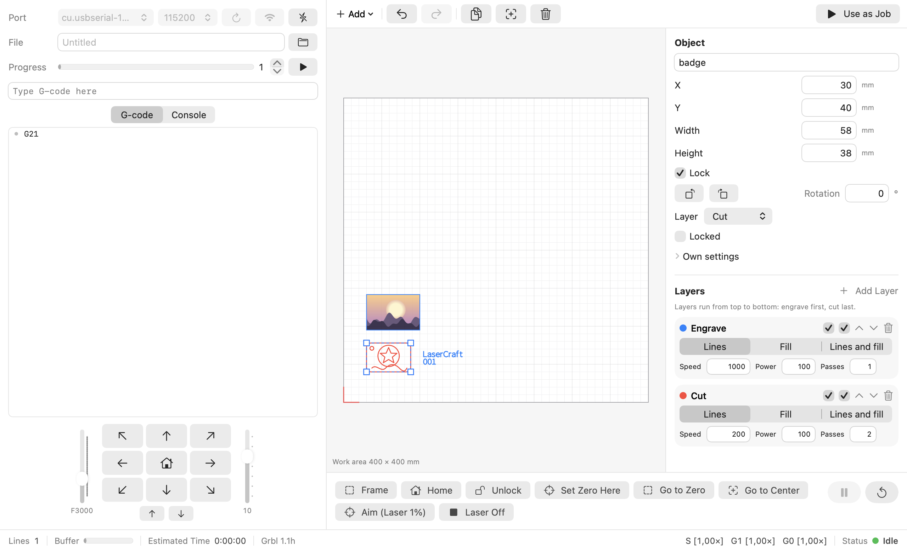

- **Add** (+) brings in a picture, an SVG, a text or a traced picture. Click an object to select it, drag it to move (it snaps
  to a 1 mm grid), drag a corner to scale (hold **⌥** to change the proportions). **Delete** removes the
  selection, **Duplicate** copies it, **Center** centres it in the work area.
- The **inspector** on the right sets position, size, rotation (pictures turn in steps of 90°), the layer and — under *Own
  settings* — a speed, power, passes or mode for this object only. Text objects can be edited there, pictures have quality,
  mirror, brightness and contrast.
- **Layers** run from top to bottom: put engraving first and cutting last, so the cut-out piece does not move while the
  engraving is burnt. Each layer has a colour, a mode (*Lines*, *Fill*, *Lines and fill*), speed, power and passes; it can be
  hidden or switched off for the burn, moved up and down.
- **Pause before a layer:** switch on *Pause before this layer* and type a message (for example "Flip the material"). The job
  stops there with the laser off and shows the message; **Resume** continues. Good for turning a piece over, changing the
  material or checking the result between engraving and cutting. (The pause is the G-code `M0`.)
- **Lower focus per pass:** for layers with several passes, a value in mm moves the Z axis down by that much with every further
  pass (cutting thick wood). It needs a machine with a Z axis; Z0 must be the focus you set before the job, and the job returns
  to Z0 at the end. 0 = no Z movement (the default).

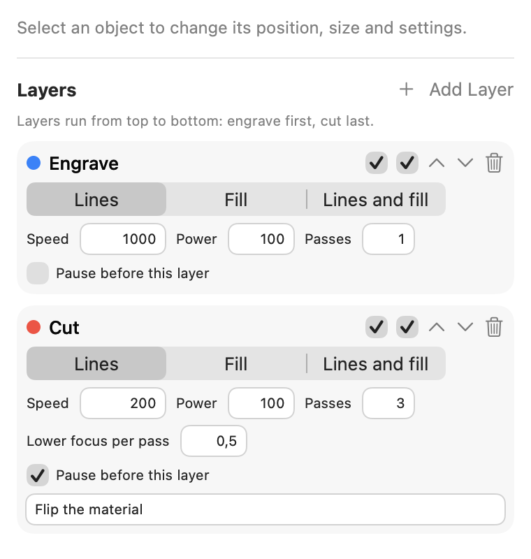
- **Zoom and pan:** pinch on the trackpad (or **⌘ + scroll**, or **⌘+ / ⌘−**) zooms around the pointer, two-finger scrolling moves the
  view, **Space + drag** pans, **⌘0** fits the work area. The percentage and the zoom buttons are in the toolbar.
- **Turning:** every object — pictures too — has a **turning handle** (the small circle above it). Drag it to turn by any angle; it
  snaps every 15° (hold **⌥** to turn freely). The *Rotation* field in the inspector takes exact angles. A turned picture is
  resampled when the job is made; the white corners of the new sheet are not engraved.
- **Several objects:** **Shift-click** adds or removes an object from the selection, **⌘A** selects all; the selection moves, copies
  and is deleted together. **Arrange → Align** lines objects up (left, centre, right, top, middle, bottom — a single object is
  aligned with the work area), **Arrange → Distribute** spaces three or more objects evenly.
- **Array:** *Arrange → Array…* makes rows × columns of copies with a gap in mm. If the selected text contains `{n}` every copy gets
  its own consecutive number (from the number you choose) — serial numbers for a batch in one step.
- **Undo / redo** (**⌘Z** / **⇧⌘Z**) cover every change, also whole drags, arrays and arranging.
- **Use as Job** (or simply **Start**) makes the G-code from the layout when it is needed. If you change the layout afterwards,
  the job is made again before the next start.

**Projects.** *File → Save Project…* (**⌥⌘S**) stores the layout with the original pictures, header and footer and the machine
profile in a folder `Name.lasercraft`; *Open Project…* (**⇧⌘O**) or a double-click in Finder opens it again. *New Project*
(**⌘N**) starts an empty layout.

## 7c. Tools

### Test patterns

*Tools → Test Patterns…* creates test jobs. They are normal jobs: you confirm the laser safety check when you start them.

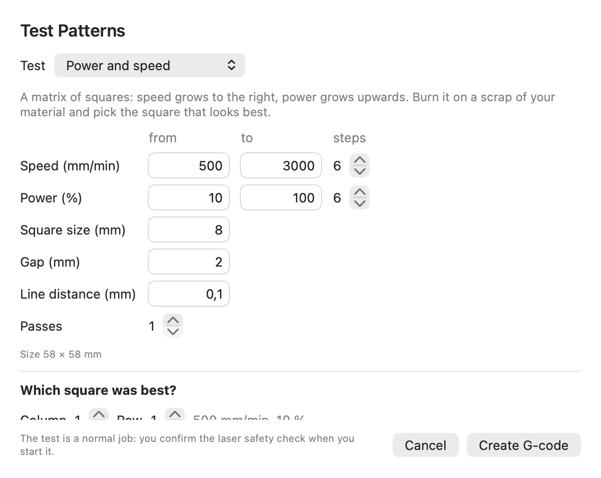

| Test | What it shows |
|---|---|
| **Power and speed** | A matrix of squares, speed growing to the right and power upwards, with the numbers engraved next to it. Burn it on a scrap, enter which square is best and press **Save as Material**. |
| **Cutting test** | Squares cut with several speeds and numbers of passes. The ones that fall out cut through. The **kerf** calculator tells how wide the beam is (nominal size minus measured piece) and how far to offset the cut. |
| **Shake test** | Short back-and-forth lines at growing feed rates with weak power. Enter the highest clean feed to get a first guess for `$120` / `$121`. |
| **Line distance and focus** | Blocks with a decreasing line distance: the finest block with separate lines is your usable resolution. |
| **Scan offset** | Nine blocks engraved in both directions with offsets from −0.4 to +0.4 mm. Use the speed of your real engravings; the block with the straightest edges shows the value for *Scan offset* in the picture import. |
| **Calibration square** | A square of 100 mm (or another size). Measure it, enter the result, and LaserCraft calculates new steps per mm for `$100` / `$101` — **Write to the machine** sends them. |

### Materials

*Tools → Materials…* is a database of power and speed settings (about 900 entries for 37 laser models, taken from LaserGRBL's
standard list) plus your own. **Material…** buttons in the SVG, text and trace sheets fill speed, power and passes from it.
Add, edit, duplicate and delete your own entries (marked ★), and share them as a JSON file with **Export…** / **Import…**.
The built-in settings are only a starting point: always test on a scrap first.

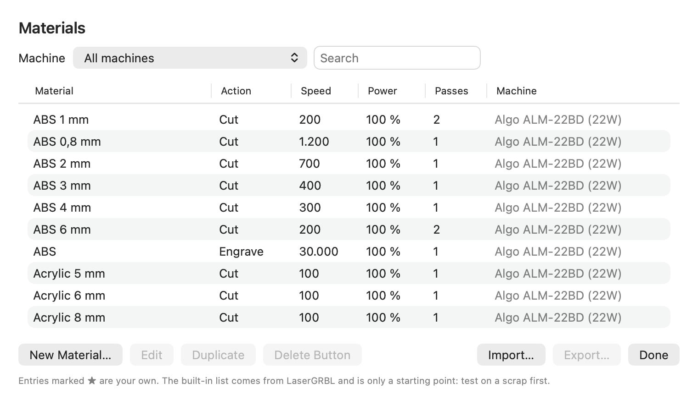

### Machine profiles and laser statistics

A **machine profile** (*Tools → Machine Profiles…*) belongs to one laser: port or network address, baud rate, header and
footer, rapid speed, laser spot size, optical power, rated life and the material list to use. When you connect to that port or
address the profile is loaded automatically.

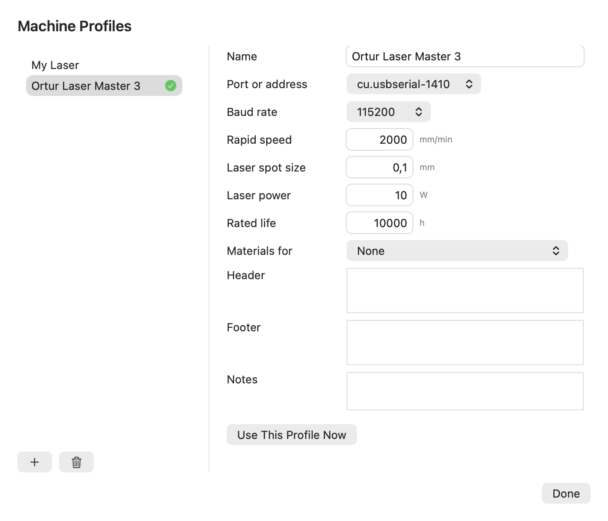

*Tools → Laser Statistics…* counts jobs, running time, the time the laser was on and the **life used**, weighted with the power
(one hour at half power counts as half an hour), from the G-code estimates of every finished or stopped job. You get a message
when the rated life is reached; **Laser Replaced** starts counting from zero. Jobs on the demo machine are not counted.

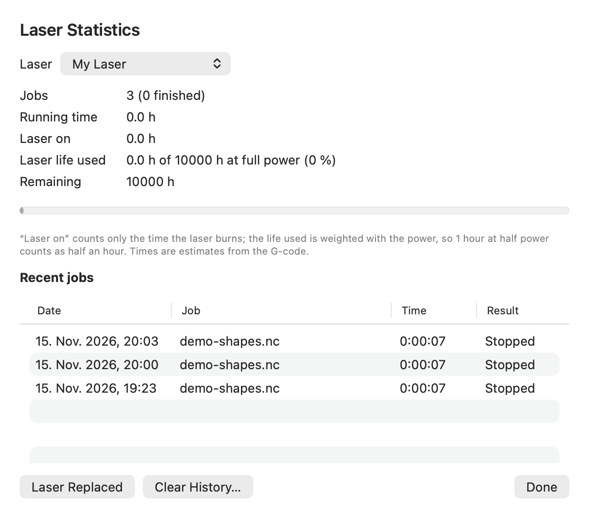

### Network machines (WiFi / Ethernet)

Next to the port list, the **WiFi** button (*Tools → Network Machines…*) adds a controller that is reachable over the network:
**Telnet** (FluidNC, Grbl_ESP32, port 23), **WebSocket** (ESP8266 add-ons such as Ortur WiFi, port 81) or **TCP** (serial-to-
network bridges). Machines found with Bonjour are listed too. Select the machine in the port list and press **Connect**; macOS
asks once for permission to use the local network. Job streaming, overrides and jogging work as over USB; only the baud rate
does not apply. The firmware is recognised from its welcome and `$I` lines: **grblHAL**, **FluidNC**, **Ortur** (with the
settings table of its firmware generation) and **Longer** show their own error, alarm and setting descriptions in English;
other controllers use the standard Grbl texts.

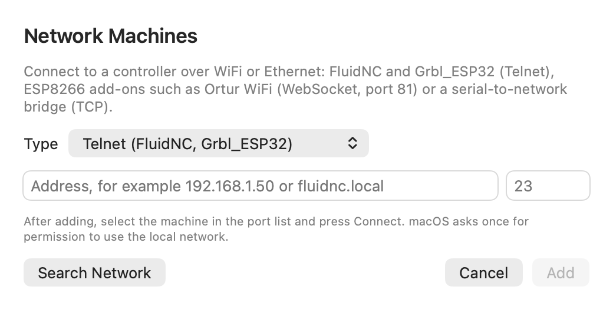

### Job history

*Tools → Job History…* lists the last 40 jobs with a small picture, date, duration, machine, number of lines and the result
(finished, stopped, failed). A copy of the G-code is kept, so **Open Again** (or a double-click) loads the job even when the file
has moved or the job came from the layout editor. The history is recorded for every job, including the demo machine.

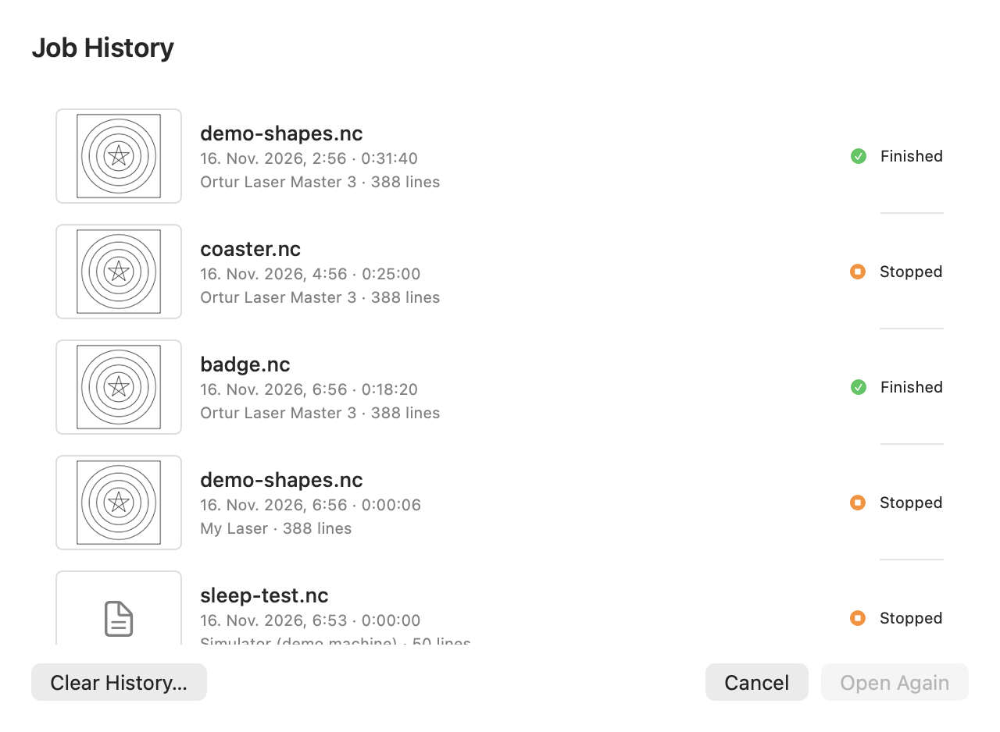

### Camera

*Tools → Camera* opens a window with the picture of a USB camera or a nearby iPhone (Continuity Camera). **Take Picture**
saves a snapshot in *Pictures/LaserCraft*; with **Time-lapse while a job runs** a picture is taken every few seconds from the
start to the end of every job. macOS asks for permission to use the camera the first time.

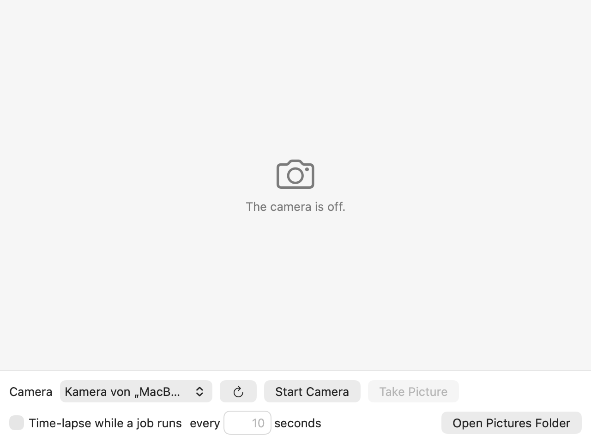

## 8. Sounds, alerts and notifications

| Event | Sound | Also |
|---|---|---|
| Connection established | Ping | |
| Connection failed | Basso | Alert with hints |
| Safety countdown | Tink every second, Pop at the end | |
| Job started | Submarine | |
| Job finished | Hero | Notification Center banner, Dock icon bounces if the app is in the background |
| Line error from Grbl | Funk | One alert per job (further errors are in the console) |
| Machine alarm | Sosumi | Alert with *Unlock* / *Home* |
| Connection lost / controller restarted | Funk | Alert — if the laser is still on, use the machine's power switch |

The volume and each group (sounds, notifications, alerts) can be changed in **Settings → General**. The safety check can not.
macOS asks for permission to show notifications when you start your first job.

**Progress in the Dock.** While a job runs the Dock icon shows a progress bar and the percentage with the remaining time
("63% · 12 min").

**Push message to your iPhone.** *Settings → General → Remote Notification* sends a message when a job ends: enter an
[ntfy](https://ntfy.sh) topic (`ntfy://my-secret-topic`; install the ntfy app on the iPhone and subscribe to the same topic) or the
address of any webhook that accepts JSON. *Only for jobs longer than … minutes* keeps short jobs quiet. The file name is **not**
sent unless you switch on *Include the file name*. *Send Test Message* checks the setup. Anyone who knows an ntfy topic name can
read its messages, so choose a long, secret name.

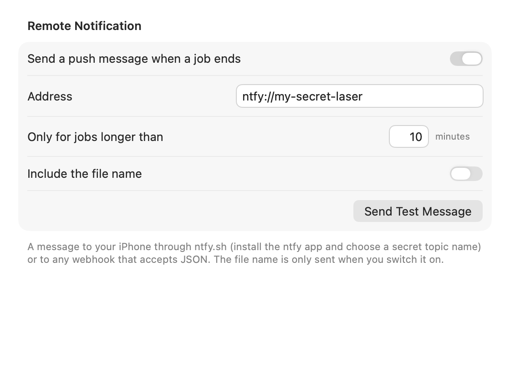

## 9. Console and G-code list

The **save** button in the console saves everything as a text file (**Machine → Save Console Log…**). **Machine → Copy Diagnostic
Report** copies versions, the machine's `$$` settings, job state and the last 200 console lines — paste it into a bug report.

Switch between **G-code** and **Console** above the list.

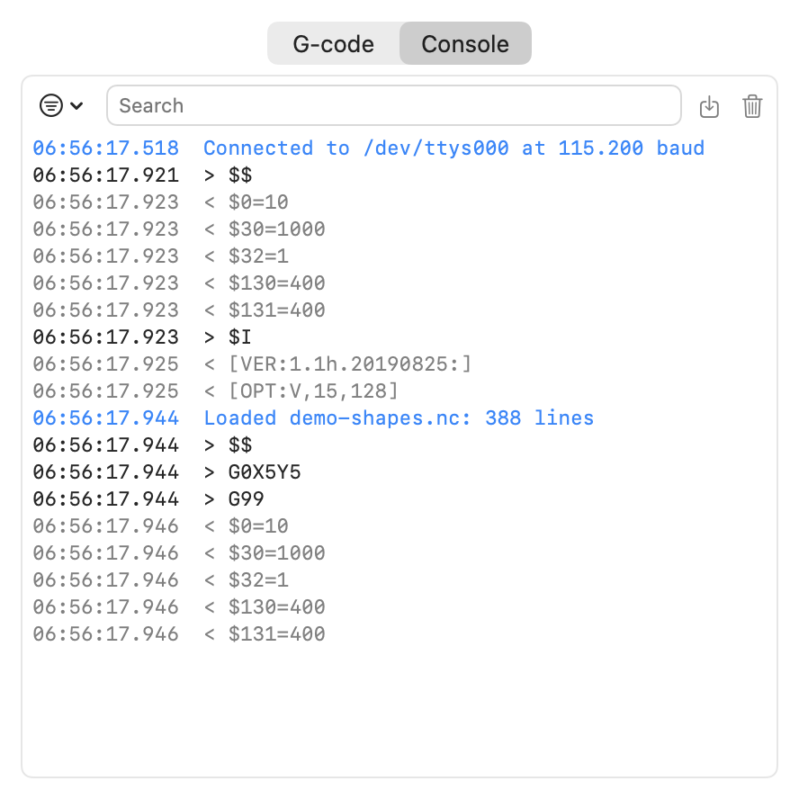

In the console the **Filter** menu shows or hides *Sent*, *Received*, *Messages* and *Errors* (*Errors Only* is one click),
the search field keeps only lines containing your text, and *Show Timestamps* and *Auto-Scroll* can be switched on and off.

- **G-code:** every line of the job. ✓ = accepted by Grbl, ✕ = Grbl reported an error, dot = waiting.
- **Console:** commands you sent (`>`), answers from the machine (`<`), and messages from the app. Errors and alarms are
  explained in plain language, for example `error:20 Unsupported command — …`. The trash button clears it.

Type a command in the **Type G-code here** field and press Return. Useful ones: `$$` (show settings), `$I` (version info),
`?` is sent automatically all the time.

## 10. Grbl configuration

Open it with the **sliders button** in the toolbar (when connected).

The table lists the controller's `$` settings with their meaning. Change a value and press **Return** to write it to the
machine. **Export…** saves all settings to a text file, **Import…** writes a file back (asks first), **Read Again** reloads.

Settings you will meet often: `$30` maximum spindle/laser value (S range), `$32` laser mode (1 = on), `$110/$111` maximum speed,
`$130/$131` machine size in mm — LaserCraft draws the machine area in the preview from the last two.
Wrong values can make the machine behave unexpectedly. Write down the old values first (Export).

## 11. Custom buttons

The button row under the preview can hold your own G-code snippets. Edit them in **Settings → Buttons**.

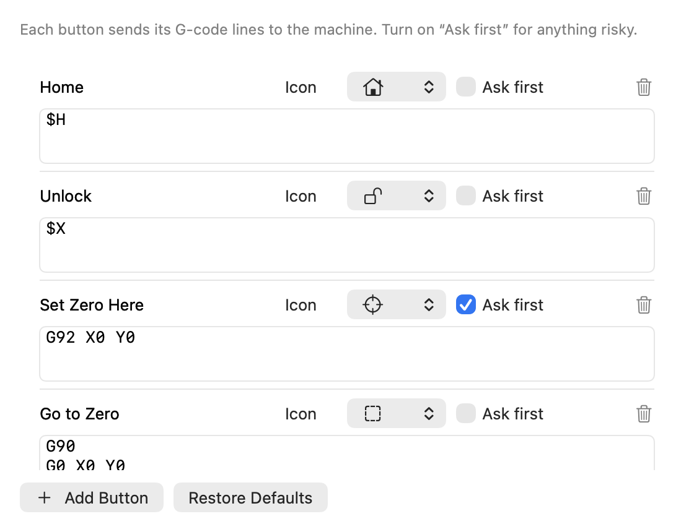

- **Name** and **Icon** (a symbol) are shown on the button; the G-code box holds one command per line.
- **Ask first** shows a confirmation before sending.
- Buttons that switch the laser on (M3 / M4) always show the safety check.
- **Add Button** creates a new one; the trash button removes one (asks first); **Restore Defaults** brings back the six
  built-in buttons (Home, Unlock, Set Zero Here, Go to Zero, Go to Center, Aim, Laser Off).

## 12. Settings

Open **LaserCraft → Settings…** (**⌘,**).

**General** — appearance, language, sounds and alerts, restore defaults.

**Connection** — default baud rate, automatic connection at launch, show or hide the simulator, default jog speed and step.

**Job** — header and footer G-code (sent before / after every job and written when you save), number of passes, frame power,
rapid speed used for time estimates until the machine reports its own, and **Power**: keep the Mac awake while a job is running
(on by default) and optionally keep the display on.

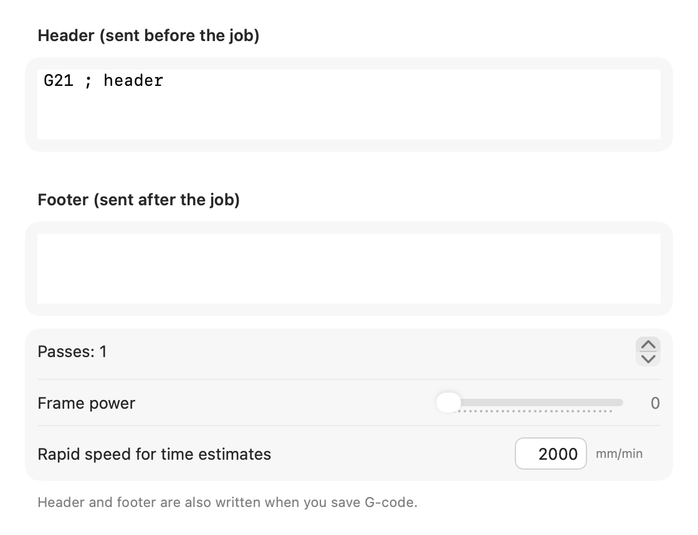

**Updates** (General) — check GitHub for a newer release once a day, or use *LaserCraft → Check for Updates…*. LaserCraft only
points you to the download page.

**Preview** — show travel moves, show grid lines, use a dark sheet in dark appearance.

**Buttons** — see [Custom buttons](#11-custom-buttons).

## 13. Languages and appearance

- **Language:** *Settings → General → Language* — System, English, Deutsch, Français, Español, Italiano, Português (Brasil), Nederlands or Polski. Nederlands and Polski cover the interface (about 80 % of the texts: menus, buttons, labels, messages); longer explanations still appear in English. Grbl's own error, alarm and setting texts are available in English, Deutsch and Français (other languages show them in English). The change is applied after a restart
  (a **Restart Now** button appears). *System* follows the order of languages in macOS System Settings.
- **Appearance:** *System*, *Light* or *Dark*, applied immediately. In dark appearance the preview stays a white sheet unless you
  turn on *Use a dark sheet in Dark appearance* in *Settings → Preview*.
- The interface supports VoiceOver; every icon has a text label and a tooltip.

## 14. Menus and keyboard shortcuts

| Shortcut | Command |
|---|---|
| ⌘O | Open G-code… |
| ⌘I | Import Image… |
| ⌘S | Save G-code… |
| ⌥⌘. | Emergency Stop |
| ⌥⌘S | Save Project… |
| ⇧⌘O | Open Project… |
| ⌘N | New Project |
| ⇧⌘I | Import Vector File… (SVG, DXF, PDF) |
| ⌘Z / ⇧⌘Z | Undo / Redo (in the layout editor) |
| ⌘K | Connect / Disconnect |
| ⌘R | Start job (shows the safety check) |
| ⌥⌘P | Pause / Resume |
| ⌘. | Stop job |
| ⇧⌘R | Soft Reset |
| ⌘, | Settings |
| ⌘+ / ⌘− / ⌘0 | Zoom in / out / fit the preview |

**File → Open Recent** lists your last ten files and projects. The **Tools** menu opens the test patterns, materials, machine profiles, statistics, network machines and the camera. The **Machine** menu also contains *Refresh Ports*, *Home*, *Unlock*, *Frame* and *Grbl configuration…*;
the **Job** menu contains *Start*, *Pause / Resume*, *Resume Job from Line…* and *Stop*. *LaserCraft → Check for Updates…* looks for a new version.

## 15. Troubleshooting

| Problem | What to try |
|---|---|
| No port in the list | Check the cable (some are charge-only), switch the laser on, press *Refresh Ports*, install the USB-chip driver (CH340 / CP210x). |
| "Connection failed" / timeout | Wrong baud rate (try 115200, then 9600 / 250000), port used by another program (close other laser software), unplug and replug. |
| Status stays **Alarm** | Press **Unlock**; run **Home** if the machine has limit switches. The alert says what caused the alarm. |
| `error: Bad number format` (with text instead of a number) | Grbl 0.9 and older answer with text. LaserCraft maps the text to the usual error number and explains it; jogging then uses G91 moves instead of `$J=`. |
| `error:9` G-code locked | The machine is in alarm or jogging — unlock first. |
| `error:20` / `error:2` … in a job | Grbl does not understand a line. The ✕ in the G-code list shows which. Check that the file is for Grbl. |
| Laser does not fire | Laser mode (`$32=1`), maximum value (`$30`) and the S values in the job must match; the G-code needs M3 / M4. |
| Engraving is mirrored or too big | Check *Width / Height* and the origin (Set Zero Here) before starting; use *Frame* to see the outline. |
| Job stops with "Controller restarted" | Power or USB glitch: check cable and power supply. |
| Job broke when the Mac slept | Keep *Settings → Job → Keep the Mac awake…* on, keep the lid open and the charger connected. |
| Buttons or text look wrong after a language change | Restart the app once (*Restart Now*). |
| Settings back to default | *Settings → General → Restore Default Settings*. |

If something unexpected happens, please open an issue with your Grbl version (shown in the status bar), what you did,
and the console text.

## 16. Glossary

- **Grbl** — the open-source firmware that runs on most hobby laser controllers.
- **G-code** — the text file of movement and laser commands (`G1 X10 Y5 S500`).
- **S value** — laser power; 0 – `$30` (often 1000).
- **M3 / M4** — laser on (constant / dynamic power); **M5** — laser off.
- **Work origin (X0 Y0)** — the corner or point where the job starts.
- **Homing** — moving to the limit switches to find the machine's absolute position.
- **Jogging** — moving the head by hand.
- **Feed hold** — pause: the machine slows to a stop and can resume.
- **Overrides** — changing speed or power while a job runs.
- **PWM** — fast on/off switching that dims the laser.
