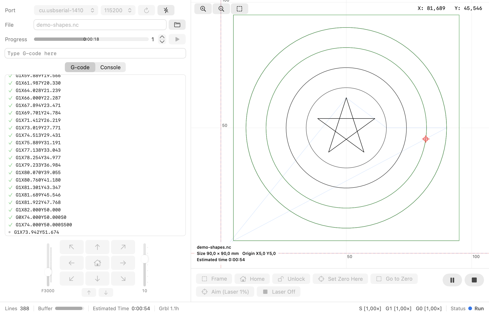
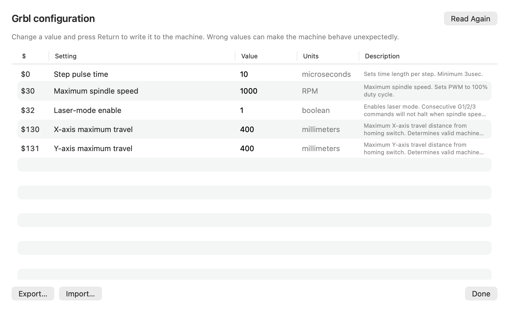
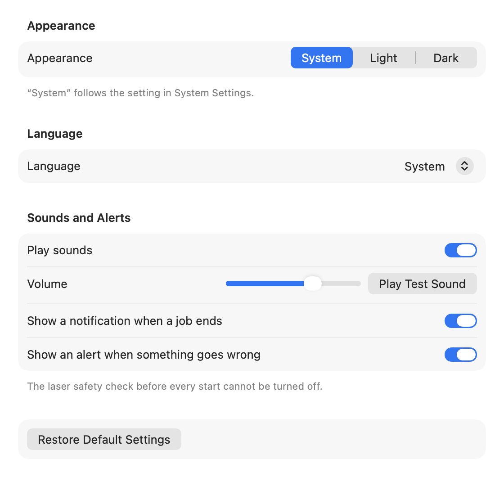
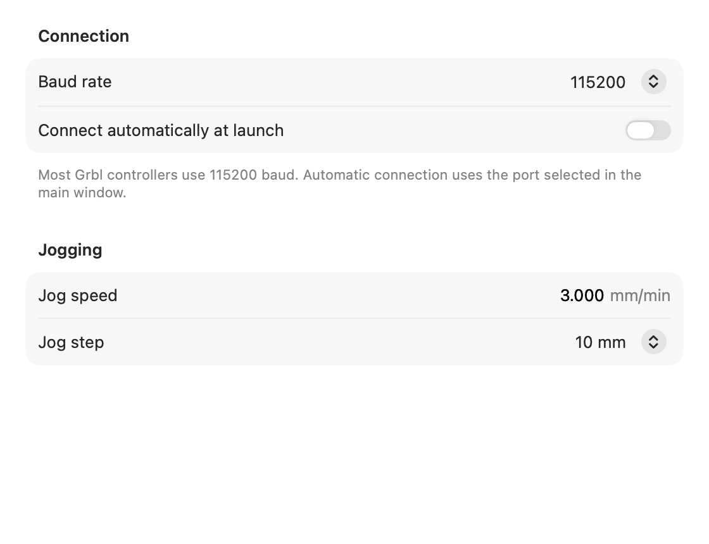
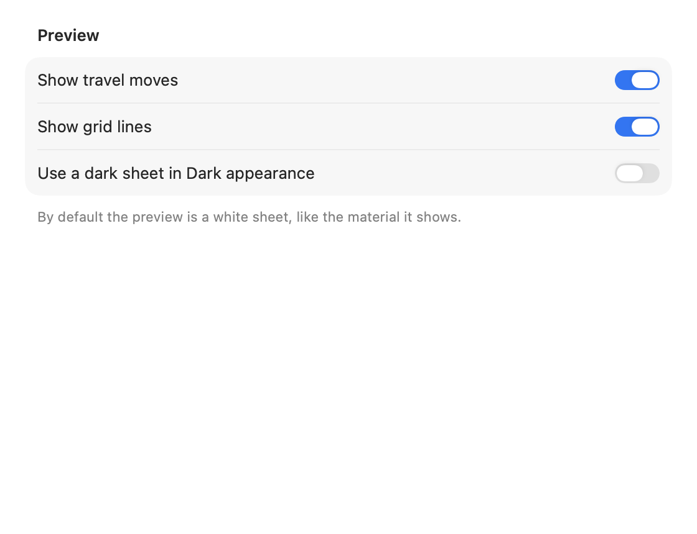

# LaserCraft — User Manual

This manual walks you through LaserCraft from the first start to your first finished engraving.
For a short overview see the [README](README.md).

**Contents**

1. [Safety first](#1-safety-first)
2. [Installation](#2-installation)
3. [The main window](#3-the-main-window)
4. [Connect to your laser](#4-connect-to-your-laser)
5. [Load something to engrave](#5-load-something-to-engrave)
6. [Position the work](#6-position-the-work)
7. [Run a job](#7-run-a-job)
8. [Sounds, alerts and notifications](#8-sounds-alerts-and-notifications)
9. [Console and G-code list](#9-console-and-g-code-list)
10. [Grbl configuration](#10-grbl-configuration)
11. [Custom buttons](#11-custom-buttons)
12. [Settings](#12-settings)
13. [Languages and appearance](#13-languages-and-appearance)
14. [Menus and keyboard shortcuts](#14-menus-and-keyboard-shortcuts)
15. [Troubleshooting](#15-troubleshooting)
16. [Glossary](#16-glossary)

---

## 1. Safety first

Laser light can permanently damage eyes — also reflected light — and can start fires.

- Wear **laser safety glasses that match your laser's wavelength** whenever the laser can fire.
- Protect everyone nearby, or use an enclosure.
- Only engrave materials that are safe to burn; remove flammable things from the area.
- **Stay at the machine** and keep a **fire extinguisher** within reach.
- Know where the machine's **power switch** is. The *Stop* button in LaserCraft is not an emergency stop.

LaserCraft reminds you before every start (see [Run a job](#7-run-a-job)), but the responsibility stays with you.

> LaserCraft has been tested with a simulated controller, not yet with real hardware. For your first run use low power,
> cover the optics, or let the machine "draw" with the laser off (Frame power 0).

## 2. Installation

**Requirements:** macOS 14 (Sonoma) or newer, a laser with a **Grbl 0.9 / 1.1** controller, a USB cable.

1. Download `LaserCraft.zip` from the Releases page and unzip it, or build the app with `./scripts/build_app.sh`.
2. Drag **LaserCraft.app** into your *Applications* folder.
3. The first time, **right-click the app → Open** and confirm (the app is signed ad hoc, not notarised).

Many laser controllers use a CH340 USB chip. Recent macOS versions include a driver; if no port appears when the laser is
plugged in, install the chip maker's driver.

## 3. The main window

The window is arranged like the Windows version of LaserGRBL.

**Left column (top to bottom)**

| Area | What it does |
|---|---|
| **Port** | Choose the serial port and baud rate, refresh the list, **connect / disconnect** (plug button). |
| **File** | Name of the loaded G-code; the folder button opens a file. |
| **Progress** | Progress bar with the remaining time, number of **passes**, and the **Start** button. |
| **Type G-code here** | Send a single command to the machine (e.g. `$$` or `G0 X10`). ↑ / ↓ recalls earlier commands. |
| **G-code / Console** | The G-code lines with ✓ (accepted) and ✕ (error), or the messages between app and machine. |
| **Jog pad** | Move the laser head. Left slider: speed. Right slider: step size. Small arrows: Z axis. |

**Right side**

| Area | What it does |
|---|---|
| **Preview** | The job as the laser will draw it: dark lines are burning, thin blue lines are travel moves, green is already done. The red cross is the laser. **X / Y** (top right) is the current work position. Use the magnifier buttons, pinch or drag to zoom and pan; the square button fits the job. |
| **Button row** | *Frame*, *Home*, *Unlock*, … and your own buttons. At the right: **Pause / Resume** and **Stop / Reset**. |
| **Toolbar** (top right of the window) | *Open G-code*, *Import Image*, *Save G-code*, *Grbl configuration*. |

**Status bar:** number of lines, Grbl's receive **buffer**, **estimated time**, messages (alarms in red), the **overrides**
S / G1 / G0 (click one to change it), and the machine **status**.

The window title shows the loaded job, the subtitle the machine state.

## 4. Connect to your laser

1. Switch the laser on and connect it with the USB cable.
2. Pick the **port** (it looks like `cu.usbserial-…` or `cu.wchusbserial…`). Press the refresh button if it is missing.
3. Leave the **baud rate** at **115200** unless your controller says otherwise.
4. Press the **plug button** (or **⌘K**).

When the controller answers you hear a short sound and the status turns to **Idle**. If it cannot connect you get a sound and
an alert with hints. **Settings → Connection** can connect automatically at launch.

If the status shows **Alarm** (common after power-up), press **Unlock** or run **Home** if your machine has limit switches.

## 5. Load something to engrave

### Open a G-code file

Press **Open G-code** (**⌘O**), drop a file on the window, or double-click it in Finder. The preview, size and time estimate
appear. Try `examples/demo-shapes.nc`.

You can **save** the job again with **⌘S** — header, footer and passes from *Settings → Job* are included.

### Turn a picture into an engraving

Press **Import Image** (**⌘I**) and choose a picture (PNG, JPEG, BMP, TIFF, GIF, HEIC). Try `examples/sample-picture.png`.

| Group | Setting | Meaning |
|---|---|---|
| Size and position | **Width / Height** | Size of the engraving in mm. **Lock** keeps the proportions. |
| | **Offset X / Y** | Where the engraving starts, in mm from the work origin. |
| Conversion | **Tool** | *Line to line*: grayscale engraving with varying power. *1 bit dithering*: black and white dots — best for low-power lasers. |
| | **Direction** | Horizontal, vertical or diagonal lines. |
| | **Engrave in one direction only** | Slower, but avoids slight offsets between left-to-right and right-to-left lines. |
| | **Quality** | Lines per mm. Higher = finer and slower. |
| | **Dithering** | Method for the dithering tool (Floyd-Steinberg, Atkinson, Burkes, Jarvis-Judice-Ninke, Random, Sierra 2/3/Lite, Stucki). |
| Picture | **Grayscale** | How colours become gray (simple, weighted, optical, or custom red/green/blue mix). |
| | **Brightness / Contrast** | 100 = unchanged. |
| | **White clip** | Very light areas are not engraved at all. |
| | **Invert** | Swap dark and light. |
| Laser | **Speed** | Engraving speed in mm/min. |
| | **Power min / max** | Power range in % of the machine's maximum (`$30`). |
| | **Laser mode** | M3 constant power, or **M4 dynamic power** (recommended with Grbl laser mode `$32=1`). |
| | **Machine supports power control (PWM)** | Turn off only for machines that can switch the laser on/off but not dim it. |

The left side shows a live preview of what will be engraved (dark = more power). Press **Create G-code**; the result appears in
the main window and can be saved or run like any other job.

## 6. Position the work

Use the **jog pad**: the arrows move the head by the **step** (right slider, 0.1 – 100 mm) at the **speed** (left slider).
The house button goes to the work origin (X0 Y0). The small arrows move the Z axis (if your machine has one).
Jogging works while the machine is **Idle**.

| Button | What it does |
|---|---|
| **Home** (`$H`) | Runs the homing cycle (machines with limit switches). |
| **Unlock** (`$X`) | Clears an alarm without homing. |
| **Set Zero Here** | Makes the current position the work origin X0 Y0 (asks first). |
| **Go to Zero** | Moves to X0 Y0. |
| **Frame** | Traces the outline of the job so you can check where it will be burned. With *Frame power* 0 the laser stays off; a value above 0 switches it on and shows the [safety check](#7-run-a-job). Set the power in *Settings → Job*. |
| **Aim (Laser 1%)** / **Laser Off** | Switches a very weak laser spot on or off for aiming (safety check applies). |

## 7. Run a job

1. Load a job and press **Start** (green play button, **⌘R** or *Job → Start*).
2. The **safety check** appears:

   

   - A **5-second countdown** ticks (one sound per second); the *Start* button counts down with it.
   - Tick **"I am wearing laser safety glasses."**
   - When the countdown is over and the box is ticked, *Start* becomes available. **Cancel** aborts. The job starts only after you confirm.

   The same check protects every button that switches the laser on (for example *Aim*) and *Frame* with power above 0.
   It cannot be turned off.
3. While the job runs:

   

   - The **G-code list** shows ✓ for accepted lines and scrolls along; the preview turns **green** where the laser has been.
   - The progress bar shows the remaining time estimate.
   - **Pause** (feed hold) stops the movement; the same button becomes **Resume**.
   - **Stop** removes the rest of the job, holds the machine and resets Grbl so the laser turns off. The position is kept.
   - Click **S**, **G1** or **G0** in the status bar to change power, speed or rapid speed **during** the job (Grbl 1.1).
4. When the job ends you hear a sound and get a macOS notification. Header and footer lines (Settings → Job) are sent
   before and after your G-code; with several **passes** the job is repeated.

**Reset** (circular arrow, **⇧⌘R**) is a soft reset of the controller when no job is running.

## 8. Sounds, alerts and notifications

| Event | Sound | Also |
|---|---|---|
| Connection established | Ping | |
| Connection failed | Basso | Alert with hints |
| Safety countdown | Tink every second, Pop at the end | |
| Job started | Submarine | |
| Job finished | Hero | Notification Center banner, Dock icon bounces if the app is in the background |
| Line error from Grbl | Funk | One alert per job (further errors are in the console) |
| Machine alarm | Sosumi | Alert with *Unlock* / *Home* |
| Connection lost / controller restarted | Funk | Alert — if the laser is still on, use the machine's power switch |

The volume and each group (sounds, notifications, alerts) can be changed in **Settings → General**. The safety check can not.
macOS asks for permission to show notifications when you start your first job.

## 9. Console and G-code list

Switch between **G-code** and **Console** above the list.

- **G-code:** every line of the job. ✓ = accepted by Grbl, ✕ = Grbl reported an error, dot = waiting.
- **Console:** commands you sent (`>`), answers from the machine (`<`), and messages from the app. Errors and alarms are
  explained in plain language, for example `error:20 Unsupported command — …`. The trash button clears it.

Type a command in the **Type G-code here** field and press Return. Useful ones: `$$` (show settings), `$I` (version info),
`?` is sent automatically all the time.

## 10. Grbl configuration

Open it with the **sliders button** in the toolbar (when connected).

The table lists the controller's `$` settings with their meaning. Change a value and press **Return** to write it to the
machine. **Export…** saves all settings to a text file, **Import…** writes a file back (asks first), **Read Again** reloads.

Settings you will meet often: `$30` maximum spindle/laser value (S range), `$32` laser mode (1 = on), `$110/$111` maximum speed,
`$130/$131` machine size in mm — LaserCraft draws the machine area in the preview from the last two.
Wrong values can make the machine behave unexpectedly. Write down the old values first (Export).

## 11. Custom buttons

The button row under the preview can hold your own G-code snippets. Edit them in **Settings → Buttons**.

- **Name** and **Icon** (a symbol) are shown on the button; the G-code box holds one command per line.
- **Ask first** shows a confirmation before sending.
- Buttons that switch the laser on (M3 / M4) always show the safety check.
- **Add Button** creates a new one; the trash button removes one (asks first); **Restore Defaults** brings back the six
  built-in buttons (Home, Unlock, Set Zero Here, Go to Zero, Aim, Laser Off).

## 12. Settings

Open **LaserCraft → Settings…** (**⌘,**).

**General** — appearance, language, sounds and alerts, restore defaults.

**Connection** — default baud rate, automatic connection at launch, default jog speed and step.

**Job** — header and footer G-code (sent before / after every job and written when you save), number of passes, frame power,
rapid speed used for time estimates until the machine reports its own.

**Preview** — show travel moves, show grid lines, use a dark sheet in dark appearance.

**Buttons** — see [Custom buttons](#11-custom-buttons).

## 13. Languages and appearance

- **Language:** *Settings → General → Language* — System, English, Deutsch or Français. The change is applied after a restart
  (a **Restart Now** button appears). *System* follows the order of languages in macOS System Settings.
- **Appearance:** *System*, *Light* or *Dark*, applied immediately. In dark appearance the preview stays a white sheet unless you
  turn on *Use a dark sheet in Dark appearance* in *Settings → Preview*.
- The interface supports VoiceOver; every icon has a text label and a tooltip.

## 14. Menus and keyboard shortcuts

| Shortcut | Command |
|---|---|
| ⌘O | Open G-code… |
| ⌘I | Import Image… |
| ⌘S | Save G-code… |
| ⌘K | Connect / Disconnect |
| ⌘R | Start job (shows the safety check) |
| ⌥⌘P | Pause / Resume |
| ⌘. | Stop job |
| ⇧⌘R | Soft Reset |
| ⌘, | Settings |

The **Machine** menu also contains *Refresh Ports*, *Home*, *Unlock*, *Frame* and *Grbl configuration…*;
the **Job** menu contains *Start*, *Pause / Resume* and *Stop*.

## 15. Troubleshooting

| Problem | What to try |
|---|---|
| No port in the list | Check the cable (some are charge-only), switch the laser on, press *Refresh Ports*, install the USB-chip driver (CH340 / CP210x). |
| "Connection failed" / timeout | Wrong baud rate (try 115200, then 9600 / 250000), port used by another program (close other laser software), unplug and replug. |
| Status stays **Alarm** | Press **Unlock**; run **Home** if the machine has limit switches. The alert says what caused the alarm. |
| `error:9` G-code locked | The machine is in alarm or jogging — unlock first. |
| `error:20` / `error:2` … in a job | Grbl does not understand a line. The ✕ in the G-code list shows which. Check that the file is for Grbl. |
| Laser does not fire | Laser mode (`$32=1`), maximum value (`$30`) and the S values in the job must match; the G-code needs M3 / M4. |
| Engraving is mirrored or too big | Check *Width / Height* and the origin (Set Zero Here) before starting; use *Frame* to see the outline. |
| Job stops with "Controller restarted" | Power or USB glitch: check cable and power supply. |
| Buttons or text look wrong after a language change | Restart the app once (*Restart Now*). |
| Settings back to default | *Settings → General → Restore Default Settings*. |

If something unexpected happens, please open an issue with your Grbl version (shown in the status bar), what you did,
and the console text.

## 16. Glossary

- **Grbl** — the open-source firmware that runs on most hobby laser controllers.
- **G-code** — the text file of movement and laser commands (`G1 X10 Y5 S500`).
- **S value** — laser power; 0 – `$30` (often 1000).
- **M3 / M4** — laser on (constant / dynamic power); **M5** — laser off.
- **Work origin (X0 Y0)** — the corner or point where the job starts.
- **Homing** — moving to the limit switches to find the machine's absolute position.
- **Jogging** — moving the head by hand.
- **Feed hold** — pause: the machine slows to a stop and can resume.
- **Overrides** — changing speed or power while a job runs.
- **PWM** — fast on/off switching that dims the laser.
