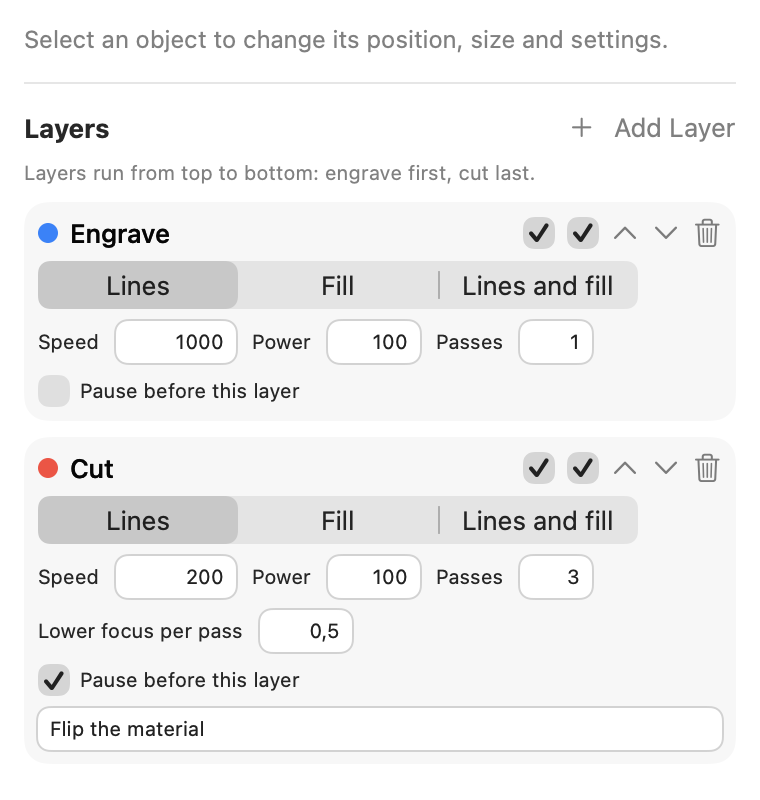

# LaserCraft

**A native Mac app to control Grbl laser engravers and cutters** — open G-code, turn pictures and vector drawings into jobs,
arrange them on the work area, preview, jog the machine and run it, with a laser-safety check before every start.


LaserCraft is written in Swift and SwiftUI and follows Apple's macOS design guidelines (standard toolbar, split view,
Settings window, light and dark mode, SF Symbols, full keyboard access). It is available in **English, Deutsch, Français,
Español, Italiano, Português (Brasil)**, plus **Nederlands** and **Polski** for most of the interface.
The layout follows the Windows program [LaserGRBL](https://github.com/arkypita/LaserGRBL), which it is based on.

**Release 1 Beta 6** (`v1.0.0-beta.6`) — see the [changelog](CHANGELOG.md) for what changed since Beta 1.

> **Status:** beta. LaserCraft is tested automatically (about 230 tests, including a simulated Grbl 1.1 controller) and has been
> confirmed working on a real **Grbl 1.1 laser on a Seeeduino Nano**. Other controllers, WiFi connections, the camera and the Z
> axis functions are not verified on real hardware yet. Please test with the laser covered or at low power first, and report
> what you find in the [issues](https://github.com/thorin-eifel/LaserCraft/issues).

## Tested with

LaserCraft is only as good as the machines it has met. This table lists what has really been tried — please add your machine with
the [hardware report](https://github.com/thorin-eifel/LaserCraft/issues/new?template=hardware-report.yml).

| Machine | Firmware | Connection | Result | By |
|---|---|---|---|---|
| Diode laser on a Seeeduino Nano | Grbl 1.1 | USB serial, 115200 baud | ✅ connecting and running jobs confirmed ("it just works") | author |
| Built-in simulator (demo machine) | Grbl 1.1 look-alike | pseudo serial port | ✅ automatic tests: streaming, jog, hold, overrides, resume, cooling, e-stop, lost "ok", `M0` pause | tests |
| Fake controller | Ortur-style Grbl 1.1 | TCP (local) | ✅ automatic test: connect, firmware detection, job | tests |
| grblHAL, FluidNC | — | USB, Telnet, WebSocket | ⚠️ detection and tables written from LaserGRBL's data, **not tried on a real machine** | — |
| Ortur / Longer controllers | — | USB, WiFi | ⚠️ not tried on a real machine | — |
| Grbl 0.9 | — | USB | ⚠️ status and error parsing covered by tests, **no real machine** | — |
| Z axis (focus step per pass) | — | — | ⚠️ only tested against the simulator | — |
| Camera window (USB / iPhone) | — | — | ⚠️ not tried on a real camera | — |

## Features

### Connect and run
- **Connect** to any Grbl 0.9 / 1.1 controller over USB serial (9600 – 921600 baud), or over **WiFi / Ethernet** (Telnet,
  WebSocket, TCP); **grblHAL**, **FluidNC**, **Ortur** and **Longer** firmware is recognised and shows its own error, alarm and
  setting texts. Live status, position and buffer.
- **Run jobs** with Grbl's character-counting protocol: header, footer, several passes, pause / resume / stop / soft reset, a
  **buffer watchdog** that rescues a job after a lost "ok", and an **Emergency Stop** button (⌥⌘.) that works in every state.
- **Resume a job** from any line (after a stop, a lost connection or a crash): the laser moves back with the laser off and
  speed, power and mode are restored first. **Auto-cooling** pauses, **auto-reconnect**, and the Mac stays awake during a job.
- **Checks before every start:** warns when the job is bigger than the machine, when laser mode is off, or when power or speed
  exceed what the machine allows — plus a laser-safety warning with a countdown that cannot be turned off.
- **Jog** with speed and step sliders, **Home**, **Unlock**, **Set Zero**, **Go to Center**, **Frame**, real-time **overrides**
  for speed, rapids and power, **keyboard control** (all keys re-assignable) and **continuous jogging** while a key is held.
- **Console** with command history, filter, search and timestamps; **G-code list** with ✓ / ✕ per line; Grbl `$` **configuration**
  table (edit, export, import).
- **Custom buttons** with icons for your own G-code snippets.
- **Notifications:** sounds, alerts, **push messages** (ntfy or webhook, with a minimum job duration), **Dock progress**.
- **Simulator:** a built-in demo machine in the port list — try everything without a laser.

### Pictures, drawings and text
- **Open G-code** (`.nc .gcode .gc .ngc .tap …`), preview it with zoom and pan, see the time estimate, save it again (with
  header / footer / line-ending options).
- **Import pictures** (PNG, JPEG, BMP, TIFF, GIF, HEIC) and convert them to engraving G-code: line-to-line or 1-bit dithering
  (9 methods), any direction, brightness, contrast, white clip, invert, power range, M3 / M4, size and offset. Crop, rotate,
  mirror, **Crop to Subject**, presets, a resolution helper and a **scan offset** for two-way engraving.
- **Vector files:** **SVG** (paths with curves and arcs, shapes, groups, transforms, units), **DXF** (lines, arcs, circles,
  ellipses, polylines, splines, blocks, units, layers) and **PDF** (the vector lines of a page, at real size).
- **Text:** single-stroke Hershey letters for engraving or the outlines of any installed font, with `{n}` serial numbers.
- **Trace pictures** into outlines or centerlines with **Bézier curve fitting** (round shapes, far fewer lines, sharp corners).
- Shortest-travel ordering and "inner shapes first" for clean cuts.


### Layout editor and projects
- Several pictures, vector files and texts on one work area, moved, scaled and **turned by any angle** with the mouse; **zoom
  and pan**; several objects at once; **align**, **distribute** and **arrays** (rows × columns, with serial numbers).
- **Layers** (engrave first, cut last) with their own speed, power, passes, a **pause before the layer** (for example to flip the
  material) and a **focus step per pass** for the Z axis. Per-object overrides.
- **Undo / redo**; G-code is made only when needed; everything is saved as a **project** (`.lasercraft`).
- **Job history** with pictures and a copy of the G-code: open an earlier job again with a double-click.

### Machines, materials and tests
- **Materials:** 900 ready-made power and speed settings for 37 laser models, your own entries, import / export.
- **Test patterns:** power-vs-speed matrix, cutting test (with kerf), shake test, line-distance / focus test, scan-offset test and
  a calibration square that calculates `$100` / `$101`.
- **Machine profiles** and **laser statistics** (hours, power-weighted lifetime).
- **Camera:** live picture of a USB or iPhone camera next to the laser, snapshots and time-lapse while a job runs.

### Everything else
- **Diagnostics:** *Copy Diagnostic Report* and *Save Console Log…* for bug reports; *Open Recent*.
- **Languages:** English, Deutsch, Français, Español, Italiano, Português (Brasil); Nederlands and Polski cover most of the
  interface (the rest shows in English). Grbl's own error texts are translated for Deutsch and Français.
- **Updates:** *Check for Updates…* looks for a newer release on GitHub; [Sparkle](https://sparkle-project.org) is built in and
  switches on for one-click updates as soon as the publisher adds a signing key ([docs/RELEASING.md](docs/RELEASING.md)).
- **Universal app** for Apple silicon and Intel, with scripts for the disk image, the update feed and notarisation.
- **Safe file reading:** damaged or hostile SVG, DXF, PDF and G-code files cannot crash the app, and an imported Grbl settings
  file can only send plain `$n=value` lines.

| Job running | Safety check |
|---|---|
|  |  |

| Layout editor | Layers with pause and focus step |
|---|---|
|  |  |

More screenshots and the complete user guide are in **[MANUAL.md](MANUAL.md)**.

## Requirements

- macOS 14 (Sonoma) or newer
- A laser with a **Grbl 0.9 or 1.1** controller (or grblHAL / FluidNC) and a USB cable or a network connection
- To build: Xcode 15 or newer (or the Swift 5.9+ toolchain); the first build downloads Sparkle through Swift Package Manager

## Install

Download the `.dmg` (or the zip) from the [Releases](https://github.com/thorin-eifel/LaserCraft/releases) page, or build it yourself:

```sh
git clone https://github.com/thorin-eifel/LaserCraft.git
cd LaserCraft
./scripts/build_app.sh        # creates build/LaserCraft.app (universal)
open build/LaserCraft.app
```

The app is signed ad hoc (not notarised). The first time, **right-click the app → Open** and confirm.

## Try it without a laser

The folder [`examples/`](examples) contains `demo-shapes.nc` (circles and a star), `sample-bracket.dxf` (a CAD drawing with
layers), `sample-badge.svg` and `sample-picture.png` (to try the image import). Open them with *Open G-code*, *Import Vector
File…* or *Import Image*. Without a laser, choose **Simulator (demo machine)** as the port and press connect: the simulated
machine moves, reports and reacts like a Grbl 1.1 controller.

## Development

```sh
swift build                    # debug build
swift test                     # protocol, G-code, importers, layout, localisation, settings and controller tests
LG_SCREENSHOT_DIR=docs/images swift test --filter "ScreenshotTests|ScreenshotsRelease3Tests|ScreenshotsBeta4Tests|ScreenshotsBeta6Tests"   # regenerate the screenshots
```

The tests include a **simulated Grbl controller on a pseudo serial port**, so streaming, flow control, jogging, overrides,
errors, alarms, pauses and aborting are tested without hardware, and the file readers are fed damaged and hostile data.

```
Sources/LaserGRBLCore   serial port and network transports, Grbl protocol and streaming, G-code parser, image / vector → G-code,
                        SVG / DXF / PDF readers, tracer and curve fitting, layout and project files (no UI)
Sources/LaserGRBLMac    the SwiftUI app
Resources               Info.plist, app icon, materials, translations (<language>.lproj)
scripts                 build_app.sh, make_dmg.sh, make_appcast.sh, translation tooling
examples                demo G-code, drawing, vector and picture
docs                    screenshots, RELEASING.md (signing, notarisation, Sparkle), DESIGN.md
Tests                   unit, integration and screenshot tests
```

Translations live in `scripts/translations*.py`; `scripts/make_strings.py` writes the `.strings` files and fails when a text
used in the code has no translation for the six complete languages.

## Not included (compared with the Windows LaserGRBL)

A port of Potrace (LaserCraft traces with its own contour and Bézier-fitting code), firmware flashing, Marlin / Smoothie / Vigo
variants, the Ortur WiFi set-up wizard, Telegram notifications (use ntfy or a webhook), the Grbl emulator window (use the
built-in simulator). Not read from DXF files: text, hatches and dimensions; not read from PDF files: pictures and shadings.

## Safety

Lasers can blind people and start fires. Always wear laser safety glasses that match your laser's wavelength, never leave a
running machine unattended, keep a fire extinguisher at hand and know where the machine's power switch is. LaserCraft's warning
is a reminder, not a replacement for your own judgement. **Use at your own risk** — see the licence.

## Credits and licence

- Based on the ideas, protocol handling and image-conversion approach of [LaserGRBL](https://github.com/arkypita/LaserGRBL)
  by Diego Settimi and contributors (GPLv3).
- Auto-update framework: [Sparkle](https://sparkle-project.org) (MIT licence).
- Icons: [SF Symbols](https://developer.apple.com/sf-symbols/). Sounds: macOS system sounds. App icon: project artwork.
- Licensed under the **GNU General Public License v3.0** — see [LICENSE.md](LICENSE.md).
