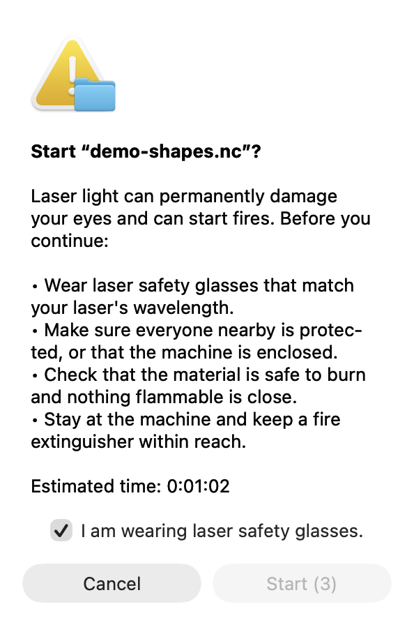

# LaserCraft

**A native Mac app to control Grbl laser engravers and cutters** — open G-code, turn pictures into engravings,
preview the job, jog the machine and run it, with a laser-safety check before every start.


LaserCraft is written in Swift and SwiftUI and follows Apple's macOS design guidelines (standard toolbar, split view,
Settings window, light and dark mode, SF Symbols, full keyboard access). It is available in **English, German and French**.
The layout follows the Windows program [LaserGRBL](https://github.com/arkypita/LaserGRBL), which it is based on.

**Release 1 Beta 1** (`v1.0.0-beta.1`) — see the [changelog](CHANGELOG.md).

> **Status:** LaserCraft has been developed and tested against a simulated Grbl 1.1 controller (automated tests, see below).
> It has **not yet been verified on real laser hardware**. Please test with the laser's optics covered or with low power first,
> and report what you find in the [issues](https://github.com/thorin-eifel/LaserCraft/issues).

## Features

- **Connect** to any Grbl 0.9 / 1.1 controller over USB serial (9600 – 921600 baud), with live status, position and buffer.
- **Open G-code** (`.nc .gcode .gc .ngc .tap …`), preview it with zoom and pan, see the time estimate, save it again.
- **Import pictures** (PNG, JPEG, BMP, TIFF, GIF, HEIC) and convert them to engraving G-code: line-to-line or 1-bit dithering
  (9 methods), horizontal / vertical / diagonal, brightness, contrast, white clip, invert, power range, M3 / M4, size and offset.
- **Run jobs** with Grbl's character-counting protocol; header, footer, several passes, pause / resume / stop / soft reset.
- **Jog** (Grbl 1.1 jog commands) with speed and step sliders, **Home**, **Unlock**, **Set Zero**, **Frame** the job outline.
- **Real-time overrides** for speed (G1), rapids (G0) and power (S).
- **Console** with command history, **G-code list** with ✓ / ✕ per line, Grbl `$` **configuration** table (edit, export, import).
- **Custom buttons** with icons for your own G-code snippets.
- **Safety first:** every start — and every button that switches the laser on — shows a laser-safety warning with a countdown
  and a "I am wearing laser safety glasses" box. It cannot be turned off.
- **Sounds, alerts and notifications:** connection established / failed, countdown, job started / finished, errors and alarms.
- **Settings** (⌘,): language, light / dark appearance, sounds, notifications, connection, job defaults, preview options.

| Job running | Safety check |
|---|---|
|  |  |

More screenshots and the complete user guide are in **[MANUAL.md](MANUAL.md)**.

## Requirements

- macOS 14 (Sonoma) or newer
- A laser with a **Grbl 0.9 or 1.1** controller and a USB cable
- To build: Xcode 15 or newer (or the Swift 5.9+ toolchain)

## Install

Download the app from the [Releases](https://github.com/thorin-eifel/LaserCraft/releases) page, or build it yourself:

```sh
git clone https://github.com/thorin-eifel/LaserCraft.git
cd LaserCraft
./scripts/build_app.sh        # creates build/LaserCraft.app
open build/LaserCraft.app
```

The app is signed ad hoc (not notarised). The first time, **right-click the app → Open** and confirm.

## Try it without a laser

The folder [`examples/`](examples) contains `demo-shapes.nc` (circles and a star) and `sample-picture.png` (to try the image
import). Open them with *Open G-code* / *Import Image*. Without a connected machine you can preview, convert and save.

## Development

```sh
swift build                    # debug build
swift test                     # protocol, G-code, image, localisation, settings and controller tests
LG_SCREENSHOT_DIR=docs/images swift test --filter ScreenshotTests   # regenerate the documentation screenshots
```

The tests include a **simulated Grbl controller on a pseudo serial port**, so streaming, flow control, jogging, overrides,
errors, alarms and aborting are tested without hardware.

```
Sources/LaserGRBLCore   serial port, Grbl protocol and streaming, G-code parser, image → G-code (no UI)
Sources/LaserGRBLMac    the SwiftUI app
Resources               Info.plist, app icon, translations (en / de / fr)
scripts                 build_app.sh, translation tooling
examples                demo G-code and picture
docs                    screenshots; DESIGN.md explains how Apple's guidelines were applied
Tests                   unit, integration and screenshot tests
```

Translations live in `scripts/translations.py`; `scripts/make_strings.py` writes the `.strings` files and fails when a text
used in the code has no German or French version.

## Not included (compared with the Windows LaserGRBL)

SVG import, vectorizing / centerline tracing, firmware flashing, WiFi (ESP8266) connection, Marlin / Smoothie / Vigo
variants, laser-life statistics, Telegram notifications, the Grbl emulator window.

## Safety

Lasers can blind people and start fires. Always wear laser safety glasses that match your laser's wavelength, never leave a
running machine unattended, keep a fire extinguisher at hand and know where the machine's power switch is. LaserCraft's warning
is a reminder, not a replacement for your own judgement. **Use at your own risk** — see the licence.

## Credits and licence

- Based on the ideas, protocol handling and image-conversion approach of [LaserGRBL](https://github.com/arkypita/LaserGRBL)
  by Diego Settimi and contributors (GPLv3).
- Icons: [SF Symbols](https://developer.apple.com/sf-symbols/). Sounds: macOS system sounds. App icon: project artwork.
- Licensed under the **GNU General Public License v3.0** — see [LICENSE.md](LICENSE.md).
