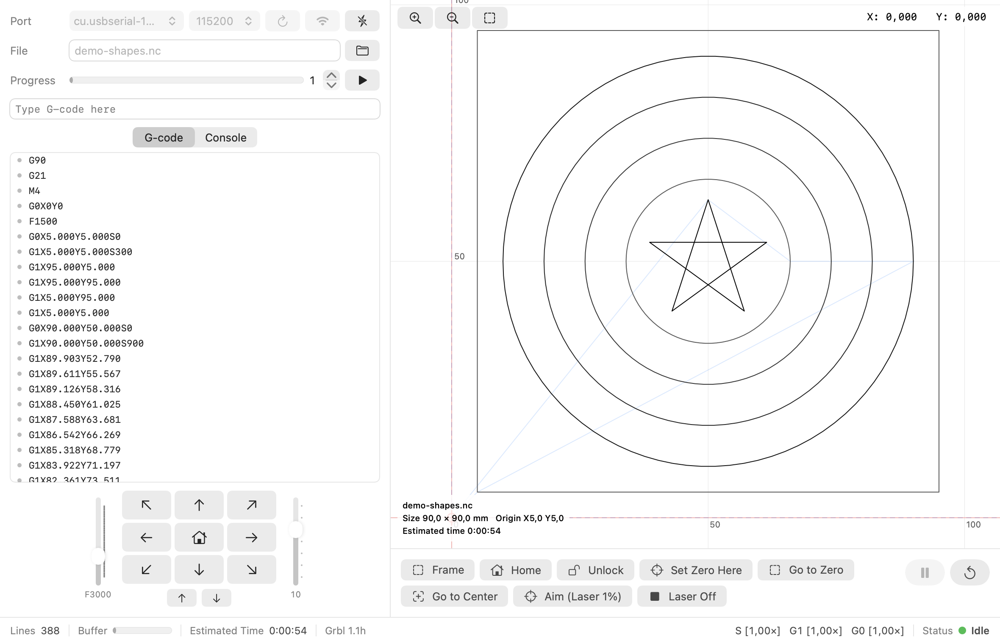
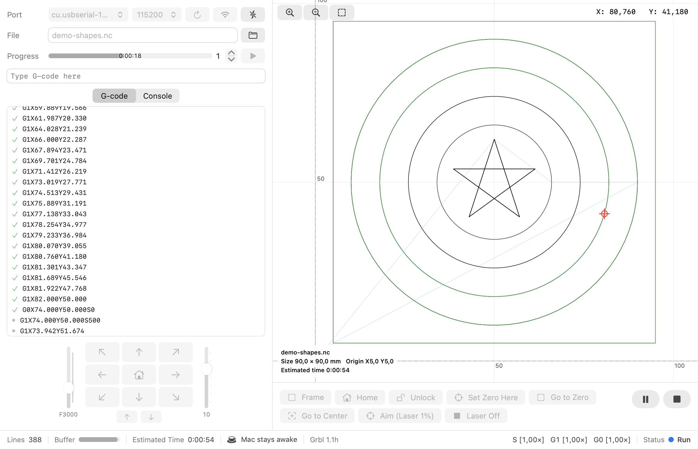

# LaserCraft

**A native Mac app to control Grbl laser engravers and cutters** — open G-code, turn pictures into engravings,
preview the job, jog the machine and run it, with a laser-safety check before every start.



LaserCraft is written in Swift and SwiftUI and follows Apple's macOS design guidelines (standard toolbar, split view,
Settings window, light and dark mode, SF Symbols, full keyboard access). It is available in **English, German and French**.
The layout follows the Windows program [LaserGRBL](https://github.com/arkypita/LaserGRBL), which it is based on.

**Release 1 Beta 1** (`v1.0.0-beta.1`) — see the [changelog](CHANGELOG.md).

> **Status:** beta. LaserCraft is tested automatically against a simulated Grbl 1.1 controller, and has been confirmed
> working on a real **Grbl 1.1 laser on a Seeeduino Nano**. Other controllers and machines are not verified yet. Please test
> with the laser covered or at low power first, and report what you find in the
> [issues](https://github.com/thorin-eifel/LaserCraft/issues).

## Features

- **Connect** to any Grbl 0.9 / 1.1 controller over USB serial (9600 – 921600 baud), with live status, position and buffer.
- **Open G-code** (`.nc .gcode .gc .ngc .tap …`), preview it with zoom and pan, see the time estimate, save it again.
- **Import pictures** (PNG, JPEG, BMP, TIFF, GIF, HEIC) and convert them to engraving G-code: line-to-line or 1-bit dithering
  (9 methods), horizontal / vertical / diagonal, brightness, contrast, white clip, invert, power range, M3 / M4, size and offset.
- **Vector files and text:** import **SVG** (paths with curves and arcs, shapes, groups, transforms, viewBox and units), add
  **text** (single-stroke Hershey letters for engraving, or the outlines of any installed font, with `{n}` serial numbers) and
  **trace pictures** into outlines or centerlines. Shortest-travel ordering and "inner shapes first" for clean cuts.
- **Layout editor:** several pictures, SVGs and texts on one work area, moved and scaled with the mouse, on **layers** (engrave
  first, cut last) with their own speed, power and passes. **Undo / redo**; G-code is made only when needed; save everything as
  a **project** (`.lasercraft`).
- **Materials:** 900 ready-made power and speed settings for 37 laser models, your own entries, import / export.
- **Test patterns:** power-vs-speed matrix, cutting test (with kerf), shake test, line-distance / focus test and a
  calibration square that calculates `$100` / `$101`.
- **More machines:** connect over **WiFi / Ethernet** (Telnet, WebSocket, TCP), detect **grblHAL**, **FluidNC**, **Ortur** and
  **Longer** firmware and show their own error, alarm and setting texts. **Machine profiles** and **laser statistics**
  (hours, power-weighted lifetime).
- **Camera:** live picture of a USB or iPhone camera next to the laser, snapshots and time-lapse while a job runs.
- **Run jobs** with Grbl's character-counting protocol; header, footer, several passes, pause / resume / stop / soft reset.
- **Checks before every start:** warns when the job is bigger than the machine (or sticks out of its area), when laser
  mode is off, or when power or speed exceed what the machine allows.
- **Simulator:** a built-in demo machine in the port list — try everything without a laser.
- **Click to move:** double-click in the preview to move the laser head there; the pointer position is shown live.
- **Diagnostics:** *Copy Diagnostic Report* and *Save Console Log…* for bug reports; *Open Recent*; zoom shortcuts.
- **Stays awake:** the Mac does not go to sleep while a job is running (it may sleep before and after). If it is forced to
  sleep anyway (closed lid), the job is paused first.
- **Resume a job** from any line (after a stop, a lost connection or a crash): LaserCraft remembers where the last run stopped,
  moves back to that point with the laser off and restores speed, power and mode before it carries on.
- **Picture tools:** crop, rotate, mirror, presets you can save, a resolution helper (lines/mm for your laser spot) and an
  engraving-time estimate.
- **Auto-cooling:** optional regular pauses (laser off) so a diode laser does not overheat; **auto-reconnect** if the USB
  connection drops while idle.
- **Updates:** *Check for Updates…* looks for a newer release on GitHub (never installs by itself).
- **Languages:** English, Deutsch, Français, Español, Italiano, Português (Brasil).
- **Universal app** for Apple silicon and Intel, with a disk-image script (`scripts/make_dmg.sh`) and a notarisation guide
  ([docs/RELEASING.md](docs/RELEASING.md)).
- **Jog** (Grbl 1.1 jog commands) with speed and step sliders, **Home**, **Unlock**, **Set Zero**, **Frame** the job outline.
- **Real-time overrides** for speed (G1), rapids (G0) and power (S).
- **Console** with command history, **G-code list** with ✓ / ✕ per line, Grbl `$` **configuration** table (edit, export, import).
- **Custom buttons** with icons for your own G-code snippets.
- **Safety first:** every start — and every button that switches the laser on — shows a laser-safety warning with a countdown
  and a "I am wearing laser safety glasses" box. It cannot be turned off.
- **Sounds, alerts and notifications:** connection established / failed, countdown, job started / finished, errors and alarms.
- **Settings** (⌘,): language (6 languages), light / dark appearance, sounds, notifications, connection, job defaults, preview options.

| Job running | Safety check |
|---|---|
|  |  |

More screenshots and the complete user guide are in **[MANUAL.md](MANUAL.md)**.

## Requirements

- macOS 14 (Sonoma) or newer
- A laser with a **Grbl 0.9 or 1.1** controller and a USB cable
- To build: Xcode 15 or newer (or the Swift 5.9+ toolchain)

## Install

Download the app from the [Releases](https://github.com/thorin-eifel/LaserCraft/releases) page, or build it yourself:

```sh
git clone https://github.com/thorin-eifel/LaserCraft.git
cd LaserCraft
./scripts/build_app.sh        # creates build/LaserCraft.app
open build/LaserCraft.app
```

The app is signed ad hoc (not notarised). The first time, **right-click the app → Open** and confirm.

## Try it without a laser

The folder [`examples/`](examples) contains `demo-shapes.nc` (circles and a star) and `sample-picture.png` (to try the image
import). Open them with *Open G-code* / *Import Image*. Without a laser, choose **Simulator (demo machine)** as the port and press
connect: the simulated machine moves, reports and reacts like a Grbl 1.1 controller.

## Development

```sh
swift build                    # debug build
swift test                     # protocol, G-code, image, localisation, settings and controller tests
LG_SCREENSHOT_DIR=docs/images swift test --filter ScreenshotTests   # regenerate the documentation screenshots
```

The tests include a **simulated Grbl controller on a pseudo serial port**, so streaming, flow control, jogging, overrides,
errors, alarms and aborting are tested without hardware.

```
Sources/LaserGRBLCore   serial port, Grbl protocol and streaming, G-code parser, image → G-code (no UI)
Sources/LaserGRBLMac    the SwiftUI app
Resources               Info.plist, app icon, translations (en / de / fr)
scripts                 build_app.sh, translation tooling
examples                demo G-code and picture
docs                    screenshots; DESIGN.md explains how Apple's guidelines were applied
Tests                   unit, integration and screenshot tests
```

Translations live in `scripts/translations.py`; `scripts/make_strings.py` writes the `.strings` files and fails when a text
used in the code has no German or French version.

## Not included (compared with the Windows LaserGRBL)

DXF / PDF import, Potrace curve fitting (the tracer makes straight segments), firmware flashing, Marlin / Smoothie / Vigo
variants, Telegram notifications, the Grbl emulator window (use the built-in simulator instead).

## Safety

Lasers can blind people and start fires. Always wear laser safety glasses that match your laser's wavelength, never leave a
running machine unattended, keep a fire extinguisher at hand and know where the machine's power switch is. LaserCraft's warning
is a reminder, not a replacement for your own judgement. **Use at your own risk** — see the licence.

## Credits and licence

- Based on the ideas, protocol handling and image-conversion approach of [LaserGRBL](https://github.com/arkypita/LaserGRBL)
  by Diego Settimi and contributors (GPLv3).
- Icons: [SF Symbols](https://developer.apple.com/sf-symbols/). Sounds: macOS system sounds. App icon: project artwork.
- Licensed under the **GNU General Public License v3.0** — see [LICENSE.md](LICENSE.md).
